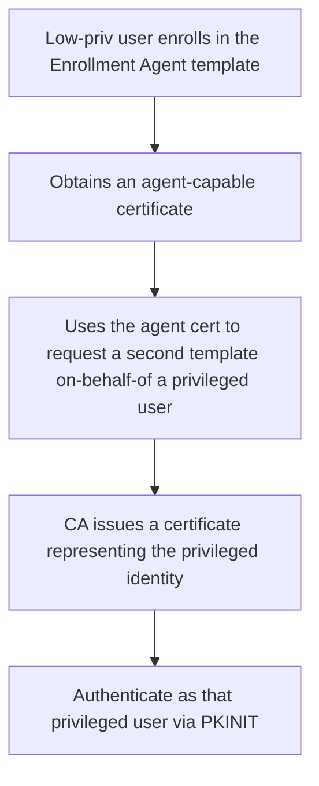
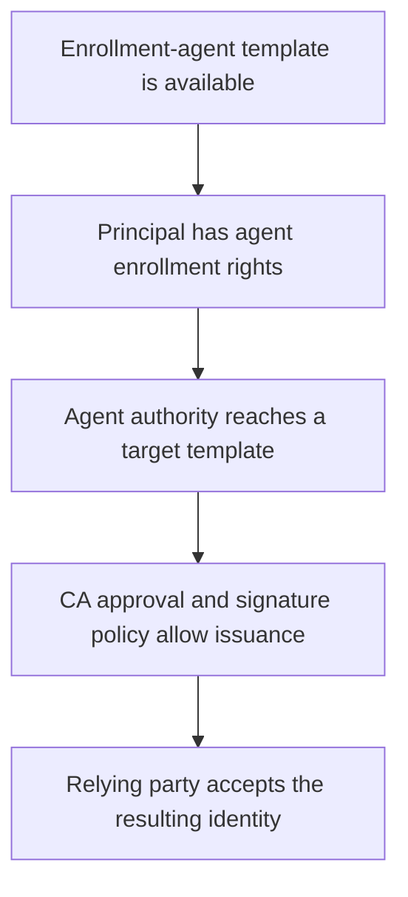

# AD CS ESC3: enrollment-agent policy

ESC3 concerns enrollment-agent certificates and the ability to request certificates on behalf of another identity. This is a legitimate delegated workflow when tightly controlled; it becomes a risk when enrollment-agent rights, target templates, or approval/signature controls are broader than the business process requires.

> **Authorized assessment only:** Do not perform on-behalf-of issuance against production identities without explicit written authorization.

## Beginner-friendly walkthrough

**In plain terms:** some certificate templates are meant for an "enrollment agent" — a trusted
role (like a help-desk officer enrolling a smartcard for someone else) that's allowed to request
a certificate *on behalf of* another user. ESC3 happens when a low-privileged account can enroll
for that agent role itself, and a second template exists that accepts agent-signed requests
without proper restriction — letting that account request a certificate as literally anyone else.

**Objects abused / affected**

| Object | Normal purpose | What ESC3 touches |
| --- | --- | --- |
| Template with `Certificate Request Agent` EKU | Lets a trusted officer enroll on behalf of others | Enrollable by a low-privileged principal when it shouldn't be |
| Target template accepting agent-signed requests | Normally restricted to specific agents/roles | Missing an `Application Policy Issuance Requirement` restriction, so any valid agent cert is accepted |
| "On behalf of" certificate | Represents the person the agent enrolled for | Can be requested for a privileged account's identity |



**Stages, and which tool typically covers each one**

1. **Find both halves of the chain** — `Certipy` and `Certify` both flag templates carrying the agent EKU with broad enrollment, and separately flag target templates that don't restrict which agent certificates they'll accept.
2. **Become an agent** — enroll in the first template using normal, already-authorized enrollment rights.
3. **Request on behalf of a target** — use the agent certificate to submit a second, on-behalf-of request naming the target identity.

The fix is almost always "restrict who can enroll in agent templates" plus "add an application-policy issuance requirement to every template that should only accept specific agents."

**Where exact command syntax lives:** this repo deliberately keeps technique pages
command-free (see `CONTRIBUTING.md`). For copy-pasteable enumeration/exploitation syntax for
this exact ESC, the authoritative public sources are the [Certipy Wiki](https://github.com/ly4k/Certipy/wiki)
(the tool that implements detection/abuse for ESC1–ESC17), [HackTricks' AD CS domain escalation page](https://book.hacktricks.xyz/windows-hardening/active-directory-methodology/ad-certificates/domain-escalation),
and the original [SpecterOps "Certified Pre-Owned" paper](https://specterops.io/wp-content/uploads/sites/3/2022/06/Certified_Pre-Owned.pdf).


## Conceptual path



## Conditions and limits

The agent certificate must be issued and accepted for the relevant workflow; the principal must have effective rights; the target template and CA must permit the delegated request; and the relying party must trust the chain and identity. Approval, authorized signatures, template restrictions and strong certificate mapping can break the path.

## Affected object and fix

```text
Objects: Enrollment-agent template, target templates, and their security descriptors
Settings to review: Enrollment-agent EKU, effective Enroll rights, issuance requirements
Risky state: Broad agent enrollment or delegated scope without required approval/signatures
Fix target: Documented agent roles, narrow target-template scope, and enforced approval policy
```

## Defensive review

Keep enrollment-agent templates unpublished when unused. Restrict agent enrollment and target-template rights to documented service roles, require appropriate authorized signatures or approval, and review whether the delegated scope is limited to expected identities and purposes.

## Detection

Correlate CA request/issuance events with agent identity, requested-for identity, template, approver, source host and later certificate authentication. Alert on unexpected requester/subject differences and changes to agent or target-template permissions.

## References

- [AD CS ESC taxonomy overview](docs/techniques/adcs_esc_matrix.md)
- [Microsoft: Certificate template concepts](https://learn.microsoft.com/windows-server/identity/ad-cs/certificate-template-concepts)
- [MITRE ATT&CK: T1649](https://attack.mitre.org/techniques/T1649/)
