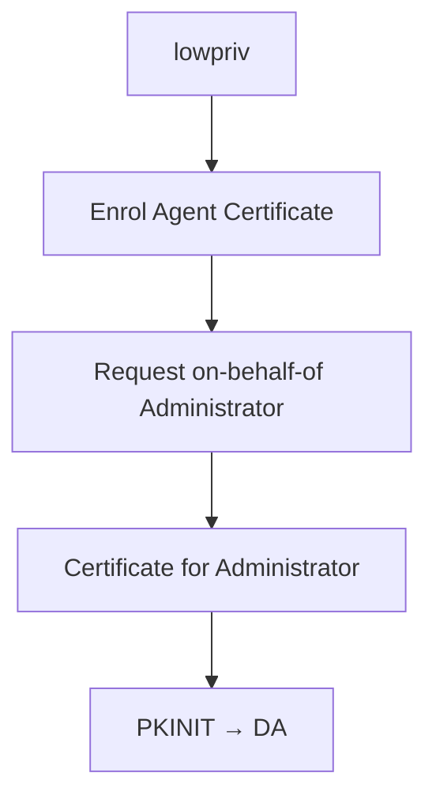

# AD CS ESC3 (enrollment-agent policy)

### Affected object / attribute
**Certificate template** with the **Certificate Request Agent EKU** and low-priv enrolment.

### Concept (deep)
The attacker obtains an **agent certificate**, then uses it to request a certificate **on behalf of** a privileged user. This is a **two-stage chain**: enrol agent → enrol on-behalf-of.

### Attack flow (Mermaid)


### Commands
```bash
