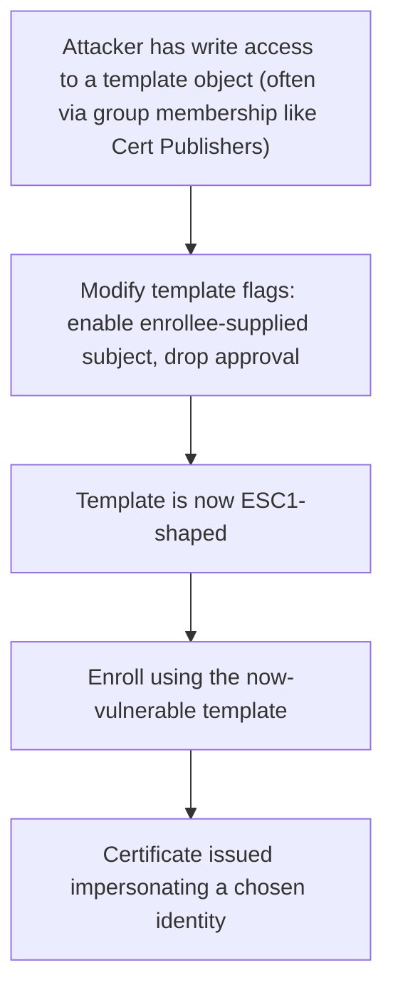
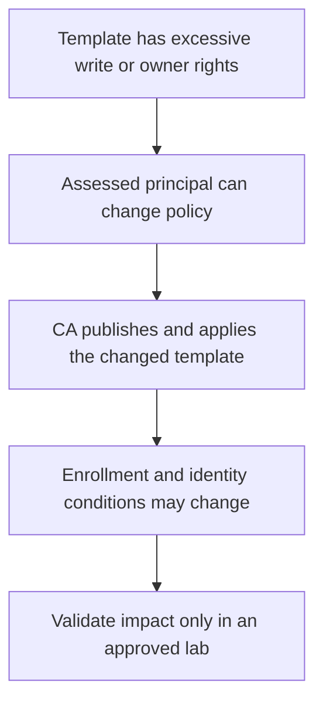

# AD CS ESC4: template ACL control

ESC4 describes a certificate template whose effective permissions allow an unintended principal to change security-relevant template settings. The risk is indirect: a principal with sufficient control may alter the issuance policy that the CA later applies.

> **Authorized assessment only:** Review permissions and configuration without changing a live template.

## Beginner-friendly walkthrough

**In plain terms:** a certificate template is itself just another AD object with an ACL. ESC4
is what happens when that ACL is too permissive — an attacker who can write to the *template
object itself* (not just enroll in it) can reconfigure it into an ESC1-style template (turn on
enrollee-supplied-subject, drop the manager-approval requirement, etc.) and then exploit their
own modified version.

**Objects abused / affected**

| Object | Normal purpose | What ESC4 touches |
| --- | --- | --- |
| Certificate template object's ACL | Should restrict who can edit template settings to PKI admins | Grants `GenericAll`/`GenericWrite`/`WriteOwner`/`WriteDacl` to a broader or wrong principal |
| Template security flags (e.g. `CT_FLAG_ENROLLEE_SUPPLIES_SUBJECT`) | Define what the template allows | Flipped on by the attacker after gaining write access |
| Resulting exploitation path | — | Becomes identical to [ESC1](adcs_esc1.md) once the template is reconfigured |



**Stages, and which tool typically covers each one**

1. **Find the ACL weakness** — `Certipy`'s and `Certify`'s enumeration modes both evaluate effective ACLs on template objects the same way `BloodHound`/`PowerView` do for any other AD object (see [ACL abuse](acl_abuse.md)).
2. **Reconfigure the template** — `Certipy`'s template-editing functionality can write the relevant flags once write access is confirmed.
3. **Exploit as ESC1** — once reconfigured, the rest of the chain is identical to [ESC1](adcs_esc1.md).

A classic real-world chain: a service account that's a member of the built-in `Cert Publishers` group (which can sometimes carry unintended write rights on templates) gets compromised first, and the attacker uses that foothold specifically for ESC4.

**Where exact command syntax lives:** this repo deliberately keeps technique pages
command-free (see `CONTRIBUTING.md`). For copy-pasteable enumeration/exploitation syntax for
this exact ESC, the authoritative public sources are the [Certipy Wiki](https://github.com/ly4k/Certipy/wiki)
(the tool that implements detection/abuse for ESC1–ESC17), [HackTricks' AD CS domain escalation page](https://book.hacktricks.xyz/windows-hardening/active-directory-methodology/ad-certificates/domain-escalation),
and the original [SpecterOps "Certified Pre-Owned" paper](https://specterops.io/wp-content/uploads/sites/3/2022/06/Certified_Pre-Owned.pdf).


## Conceptual path



## Conditions and limits

Effective control depends on the template DACL, ownership, inheritance, nested groups, CA publication, replication and the exact attribute that can be changed. A writable template is not automatically exploitable; CA policy and relying-party behavior still matter.

## Affected object and fix

```text
Object: pKICertificateTemplate
Setting to review: nTSecurityDescriptor, owner, inherited ACEs, and write-property rights
Risky state: Non-PKI principals can change the template or its security descriptor
Fix target: Only designated PKI administrators can modify template policy or ACLs
```

## Defensive review

Resolve effective rights on every authentication-capable template, including inherited permissions and group nesting. Restrict owner, DACL and write-property rights to tiered PKI administrators. Remove unnecessary publication and compare settings with an approved baseline.

## Detection

Audit directory changes to `pKICertificateTemplate` objects, especially owner/DACL and identity, EKU, approval or enrollment flags. Correlate changes with CA issuance, replication and certificate-authentication activity.

## References

- [AD CS ESC taxonomy overview](docs/techniques/adcs_esc_matrix.md)
- [Microsoft: Certificate template concepts](https://learn.microsoft.com/windows-server/identity/ad-cs/certificate-template-concepts)
- [MITRE ATT&CK: T1649](https://attack.mitre.org/techniques/T1649/)
