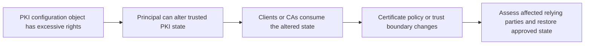

# AD CS ESC5: PKI object permissions

ESC5 is a broad category for excessive control over security-relevant PKI objects outside a single certificate template. Depending on the object, changes can affect CA configuration, published policy, issuance semantics or which CA chains are trusted.

> **Authorized assessment only:** Limit validation to directory and CA configuration review; do not modify trust or PKI objects in production.

## Conceptual path



## Conditions and limits

Impact depends on the exact object, its consumers, replication, CA policy and relying-party trust. A write permission on an unrelated or unused object may not create a meaningful path; identify the object's role before scoring.

## Affected object and fix

```text
Objects: Enterprise CA, enrollment-service, OID, NTAuth, and related PKI objects
Setting to review: nTSecurityDescriptor and object-specific write/owner permissions
Risky state: Unapproved principals can alter trusted PKI configuration or trust state
Fix target: Tiered PKI administration, change control, and monitored least-privilege ACLs
```

## Defensive review

Inventory ACLs for enterprise CA, OID, enrollment-service, NTAuth and related configuration objects. Limit writes to designated PKI administrators, use change control for trust modifications, and maintain known-good configuration exports and recovery procedures.

## Detection

Enable directory auditing for PKI object and security-descriptor changes. Correlate event 5136 or equivalent with CA configuration, issuance, certificate-chain and authentication events.

## References

- [AD CS ESC taxonomy overview](docs/techniques/adcs_esc_matrix.md)
- [Microsoft: Active Directory Certificate Services overview](https://learn.microsoft.com/windows-server/identity/ad-cs/active-directory-certificate-services-overview)
- [MITRE ATT&CK: T1649](https://attack.mitre.org/techniques/T1649/)
