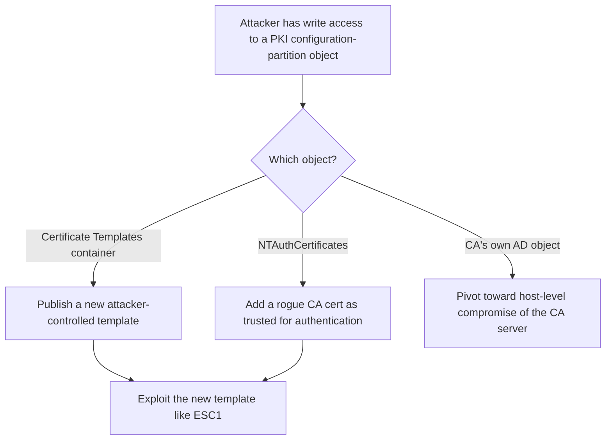
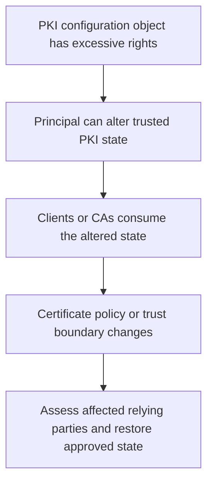

# AD CS ESC5: PKI object permissions

ESC5 is a broad category for excessive control over security-relevant PKI objects outside a single certificate template. Depending on the object, changes can affect CA configuration, published policy, issuance semantics or which CA chains are trusted.

> **Authorized assessment only:** Limit validation to directory and CA configuration review; do not modify trust or PKI objects in production.

## Beginner-friendly walkthrough

**In plain terms:** ESC4 was about one template's ACL being wrong. ESC5 is the broader version
of the same idea: *any* PKI-related object in AD's Configuration partition — the Certificate
Templates container itself, the CA's own AD object, the `NTAuthCertificates` object, or the PKI
Services container — can carry an ACL weakness. Getting write access to the right container can
be even more powerful than one template, since it can mean publishing a new rogue template or
adding a rogue CA to the trusted list.

**Objects abused / affected**

| Object | Normal purpose | What ESC5 touches |
| --- | --- | --- |
| Certificate Templates container | Holds all template objects | Write access lets an attacker publish an entirely new, attacker-controlled template |
| `NTAuthCertificates` object | Lists CAs trusted for client authentication | Write access lets an attacker add a rogue/forged CA certificate as trusted |
| CA's own AD computer/service object | Represents the CA server in the directory | Write access can lead to the host-level compromise class (see [lateral movement](wmi_exec.md), [cred access](lsass_dump.md)) |



**Stages, and which tool typically covers each one**

1. **Find the weakness** — this is a Configuration-partition ACL finding, surfaced the same way as [AD Sites ACL abuse](sites_acl_abuse.md): `BloodHound`'s collectors and `PowerView` both walk Configuration-partition objects, not just the domain partition.
2. **Act on it** — `Certipy` and `BloodyAD` both support writing to Configuration-partition PKI objects once the right is confirmed.

Because this touches the Configuration partition (shared across the whole forest), an ESC5 finding in one domain can have forest-wide implications — treat these ACLs with the same care as domain-controller ACLs.

**Where exact command syntax lives:** this repo deliberately keeps technique pages
command-free (see `CONTRIBUTING.md`). For copy-pasteable enumeration/exploitation syntax for
this exact ESC, the authoritative public sources are the [Certipy Wiki](https://github.com/ly4k/Certipy/wiki)
(the tool that implements detection/abuse for ESC1–ESC17), [HackTricks' AD CS domain escalation page](https://book.hacktricks.xyz/windows-hardening/active-directory-methodology/ad-certificates/domain-escalation),
and the original [SpecterOps "Certified Pre-Owned" paper](https://specterops.io/wp-content/uploads/sites/3/2022/06/Certified_Pre-Owned.pdf).


## Conceptual path



## Conditions and limits

Impact depends on the exact object, its consumers, replication, CA policy and relying-party trust. A write permission on an unrelated or unused object may not create a meaningful path; identify the object's role before scoring.

## Affected object and fix

```text
Objects: Enterprise CA, enrollment-service, OID, NTAuth, and related PKI objects
Setting to review: nTSecurityDescriptor and object-specific write/owner permissions
Risky state: Unapproved principals can alter trusted PKI configuration or trust state
Fix target: Tiered PKI administration, change control, and monitored least-privilege ACLs
```

## Defensive review

Inventory ACLs for enterprise CA, OID, enrollment-service, NTAuth and related configuration objects. Limit writes to designated PKI administrators, use change control for trust modifications, and maintain known-good configuration exports and recovery procedures.

## Detection

Enable directory auditing for PKI object and security-descriptor changes. Correlate event 5136 or equivalent with CA configuration, issuance, certificate-chain and authentication events.

## References

- [AD CS ESC taxonomy overview](docs/techniques/adcs_esc_matrix.md)
- [Microsoft: Active Directory Certificate Services overview](https://learn.microsoft.com/windows-server/identity/ad-cs/active-directory-certificate-services-overview)
- [MITRE ATT&CK: T1649](https://attack.mitre.org/techniques/T1649/)
