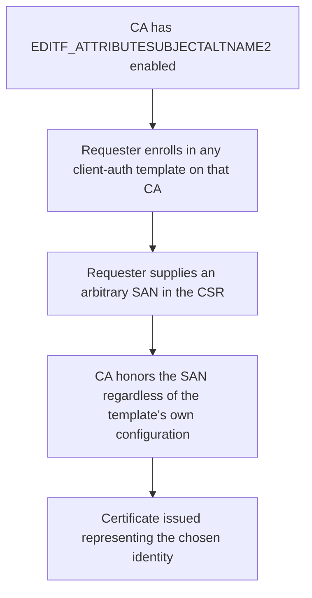
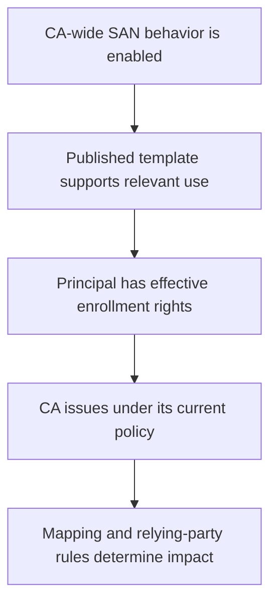

# AD CS ESC6: CA-wide SAN policy

ESC6 concerns a CA-wide setting that may allow a requester to supply subject alternative name (SAN) information through request attributes. If combined with an authentication-capable template and permissive enrollment, this can weaken the intended link between a certificate and the requester's directory identity.

> **Authorized assessment only:** Inspect CA policy and template configuration read-only. Do not request identity-substituting certificates outside an isolated approved lab.

## Beginner-friendly walkthrough

**In plain terms:** ESC1 is about one *template* letting the requester supply their own
identity (SAN). ESC6 is the CA-wide equivalent: a flag called
`EDITF_ATTRIBUTESUBJECTALTNAME2` can be set on the Certification Authority itself, and when it
is, the CA will honor an attacker-supplied SAN on **any** request to **any** client-auth-capable
template — turning every such template into an ESC1-style template at once, template
configuration notwithstanding.

**Objects abused / affected**

| Object | Normal purpose | What ESC6 touches |
| --- | --- | --- |
| CA policy flag `EDITF_ATTRIBUTESUBJECTALTNAME2` | Legacy compatibility setting, should be off by default | When enabled, overrides every template's own SAN restriction CA-wide |
| Every client-authentication-capable template on that CA | Normally each has its own, individually-reviewed SAN policy | All become effectively ESC1-vulnerable while the flag is set |



**Stages, and which tool typically covers each one**

1. **Check the flag** — `Certipy`'s CA-enumeration mode and `Certify` both query the CA's registry-backed policy flags remotely (where permitted) and flag `EDITF_ATTRIBUTESUBJECTALTNAME2` directly.
2. **Exploit it** — once confirmed, exploitation looks exactly like [ESC1](adcs_esc1.md), just against any client-auth template on that CA instead of one specifically-misconfigured template.
3. **Why ESC7 matters here** — an attacker with `ManageCA` rights ([ESC7](adcs_esc7.md)) can *enable* this flag themselves, chaining the two together.

Microsoft's own guidance has flagged this setting for years; its presence on a production CA almost always indicates either legacy carry-over configuration or an undetected prior compromise.

**Where exact command syntax lives:** this repo deliberately keeps technique pages
command-free (see `CONTRIBUTING.md`). For copy-pasteable enumeration/exploitation syntax for
this exact ESC, the authoritative public sources are the [Certipy Wiki](https://github.com/ly4k/Certipy/wiki)
(the tool that implements detection/abuse for ESC1–ESC17), [HackTricks' AD CS domain escalation page](https://book.hacktricks.xyz/windows-hardening/active-directory-methodology/ad-certificates/domain-escalation),
and the original [SpecterOps "Certified Pre-Owned" paper](https://specterops.io/wp-content/uploads/sites/3/2022/06/Certified_Pre-Owned.pdf).


## Conceptual path



## Conditions and limits

The CA setting alone does not establish a path. Template publication, effective enrollment, EKU, approval/signature requirements, CA policy, chain trust and strong account mapping all affect whether a certificate is accepted for an unintended identity.

## Affected object and fix

```text
Object: Enterprise CA policy/configuration
Setting to review: EditFlags and EDITF_ATTRIBUTESUBJECTALTNAME2 behavior
Risky state: CA-wide requester-supplied SAN handling is enabled without a required use case
Fix target: Disable unnecessary SAN handling; keep identity directory-derived and enrollment narrow
```

## Defensive review

Disable CA-wide SAN behavior unless a documented service requires it. Prefer directory-derived identity fields; restrict authentication-template enrollment; and test application compatibility in a lab before changing CA policy.

## Detection

Baseline CA configuration and SAN patterns. Correlate request/issuance events 4886/4887, requester, template, submitted identity, source host and later certificate authentication; audit changes to CA policy.

## References

- [AD CS ESC taxonomy overview](docs/techniques/adcs_esc_matrix.md)
- [Microsoft: Active Directory Certificate Services overview](https://learn.microsoft.com/windows-server/identity/ad-cs/active-directory-certificate-services-overview)
- [MITRE ATT&CK: T1649](https://attack.mitre.org/techniques/T1649/)
