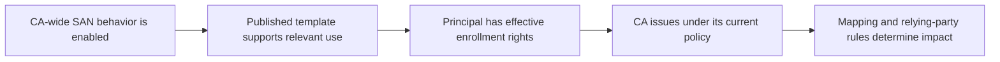

# AD CS ESC6: CA-wide SAN policy

ESC6 concerns a CA-wide setting that may allow a requester to supply subject alternative name (SAN) information through request attributes. If combined with an authentication-capable template and permissive enrollment, this can weaken the intended link between a certificate and the requester's directory identity.

> **Authorized assessment only:** Inspect CA policy and template configuration read-only. Do not request identity-substituting certificates outside an isolated approved lab.

## Conceptual path



## Conditions and limits

The CA setting alone does not establish a path. Template publication, effective enrollment, EKU, approval/signature requirements, CA policy, chain trust and strong account mapping all affect whether a certificate is accepted for an unintended identity.

## Affected object and fix

```text
Object: Enterprise CA policy/configuration
Setting to review: EditFlags and EDITF_ATTRIBUTESUBJECTALTNAME2 behavior
Risky state: CA-wide requester-supplied SAN handling is enabled without a required use case
Fix target: Disable unnecessary SAN handling; keep identity directory-derived and enrollment narrow
```

## Defensive review

Disable CA-wide SAN behavior unless a documented service requires it. Prefer directory-derived identity fields; restrict authentication-template enrollment; and test application compatibility in a lab before changing CA policy.

## Detection

Baseline CA configuration and SAN patterns. Correlate request/issuance events 4886/4887, requester, template, submitted identity, source host and later certificate authentication; audit changes to CA policy.

## References

- [AD CS ESC taxonomy overview](docs/techniques/adcs_esc_matrix.md)
- [Microsoft: Active Directory Certificate Services overview](https://learn.microsoft.com/windows-server/identity/ad-cs/active-directory-certificate-services-overview)
- [MITRE ATT&CK: T1649](https://attack.mitre.org/techniques/T1649/)
