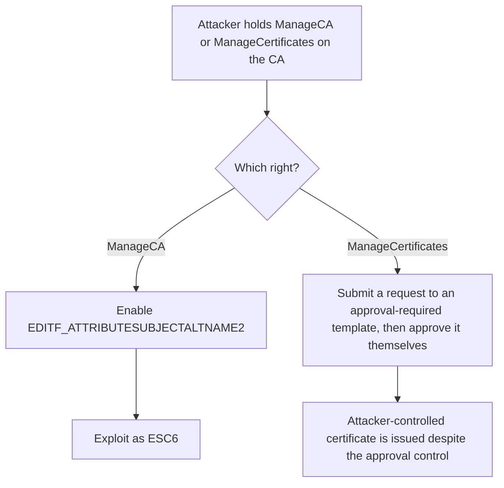
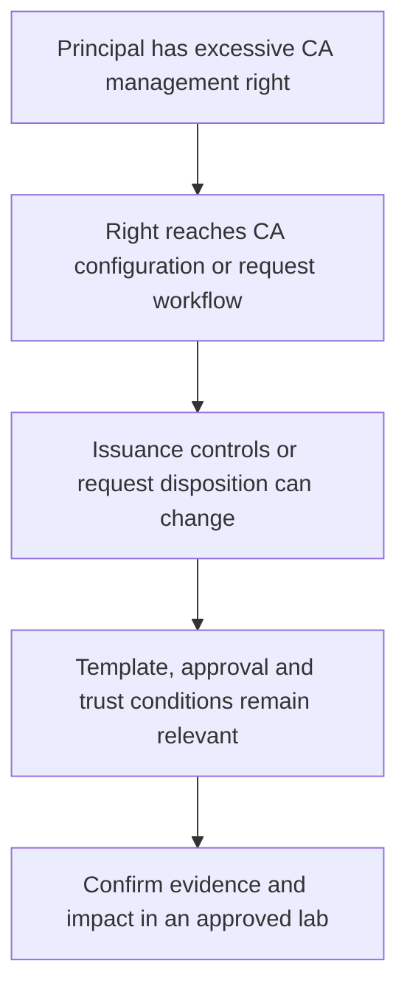

# AD CS ESC7: CA management rights

ESC7 concerns excessive CA-level management permissions. CA rights such as managing CA configuration or certificate requests are operationally sensitive and can change issuance controls or influence request disposition. The exact risk depends on the CA role and enabled policy.

> **Authorized assessment only:** Review role assignments and audit history. Do not alter CA configuration or approve requests as a test without explicit authorization.

## Beginner-friendly walkthrough

**In plain terms:** the CA itself has administrative roles — `ManageCA` (full CA administration)
and `ManageCertificates` (certificate officer, can approve/deny pending requests). ESC7 is what
happens when either of those rights is handed to an account that shouldn't have it. `ManageCA`
can be used to flip the dangerous flag from [ESC6](adcs_esc6.md); `ManageCertificates` can be
used to approve a request that was only issued as "pending" because the template required
manager approval — turning a blocked request into a live certificate.

**Objects abused / affected**

| Right | Normal purpose | How ESC7 abuses it |
| --- | --- | --- |
| `ManageCA` | Full administrative control of the CA | Can enable `EDITF_ATTRIBUTESUBJECTALTNAME2` ([ESC6](adcs_esc6.md)) or add officers |
| `ManageCertificates` ("Certificate Manager"/officer role) | Approve, deny, or revoke pending/issued certificates | Can approve an attacker's own pending request, bypassing the approval control |



**Stages, and which tool typically covers each one**

1. **Find the right** — `Certipy`'s CA-enumeration mode and `Certify` both read the CA's security descriptor and flag non-admin principals holding `ManageCA`/`ManageCertificates`.
2. **Exercise it** — the same tools support flipping CA flags (if `ManageCA`) or approving a pending request (if `ManageCertificates`) once the right is confirmed.

This is conceptually the ADCS version of [ACL abuse](acl_abuse.md) — the only difference is that the "object" being over-delegated is the Certification Authority itself rather than a user or group.

**Where exact command syntax lives:** this repo deliberately keeps technique pages
command-free (see `CONTRIBUTING.md`). For copy-pasteable enumeration/exploitation syntax for
this exact ESC, the authoritative public sources are the [Certipy Wiki](https://github.com/ly4k/Certipy/wiki)
(the tool that implements detection/abuse for ESC1–ESC17), [HackTricks' AD CS domain escalation page](https://book.hacktricks.xyz/windows-hardening/active-directory-methodology/ad-certificates/domain-escalation),
and the [SpecterOps "Certificates and Pwnage and Patches, Oh My!" post](https://specterops.io/blog/2022/11/09/certificates-and-pwnage-and-patches-oh-my) that introduced several later ESCs.


## Conceptual path



## Conditions and limits

The assigned CA right, CA policy, request state, template eligibility and relying-party acceptance determine impact. Distinguish configuration management from certificate-manager actions, and do not infer domain privilege from a CA role alone.

## Affected object and fix

```text
Object: Enterprise CA security descriptor and administrative role assignments
Settings to review: Manage CA and Manage Certificates rights
Risky state: Rights assigned beyond the documented PKI administration/approval workflow
Fix target: Named, tiered roles; separation of duties where practical; audited approvals
```

## Defensive review

Restrict CA administration and certificate approval to documented, tiered roles. Separate duties where practical, protect privileged groups, require change control, and review emergency access and stale assignments.

## Detection

Audit CA role changes, configuration changes, request approvals/denials, issuance and administrative logons. Correlate CA events with directory changes, requester identity and subsequent certificate use.

## References

- [AD CS ESC taxonomy overview](docs/techniques/adcs_esc_matrix.md)
- [Microsoft: Active Directory Certificate Services overview](https://learn.microsoft.com/windows-server/identity/ad-cs/active-directory-certificate-services-overview)
- [MITRE ATT&CK: T1649](https://attack.mitre.org/techniques/T1649/)
