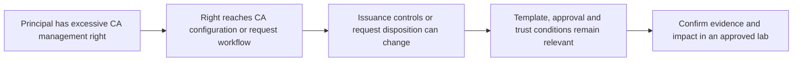

# AD CS ESC7: CA management rights

ESC7 concerns excessive CA-level management permissions. CA rights such as managing CA configuration or certificate requests are operationally sensitive and can change issuance controls or influence request disposition. The exact risk depends on the CA role and enabled policy.

> **Authorized assessment only:** Review role assignments and audit history. Do not alter CA configuration or approve requests as a test without explicit authorization.

## Conceptual path

## Conditions and limits

The assigned CA right, CA policy, request state, template eligibility and relying-party acceptance determine impact. Distinguish configuration management from certificate-manager actions, and do not infer domain privilege from a CA role alone.

## Defensive review

Restrict CA administration and certificate approval to documented, tiered roles. Separate duties where practical, protect privileged groups, require change control, and review emergency access and stale assignments.

## Detection

Audit CA role changes, configuration changes, request approvals/denials, issuance and administrative logons. Correlate CA events with directory changes, requester identity and subsequent certificate use.

## References

- [AD CS ESC taxonomy overview](docs/techniques/adcs_esc_matrix.md)
- [Microsoft: Active Directory Certificate Services overview](https://learn.microsoft.com/windows-server/identity/ad-cs/active-directory-certificate-services-overview)
- [MITRE ATT&CK: T1649](https://attack.mitre.org/techniques/T1649/)
