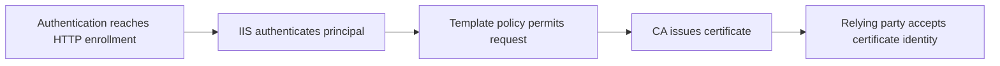

# ADCS ESC8 (NTLM relay to CA web enrollment)

ESC8 describes NTLM authentication relayed to an enterprise CA HTTP enrollment endpoint. Web enrollment normally permits authorized enrollment, but IIS authentication, endpoint binding and template policy must preserve the authenticated identity and prevent unintended issuance.

> **Authorized assessment only:** This guide is for controlled labs and explicitly authorized reviews. It provides no relay commands, coercion procedures or credential-reuse instructions.

## AD CS and IIS objects

The enterprise CA, IIS web-enrollment virtual directories, HTTP/RPC enrollment services, IIS authentication settings, NTLM/EPA/channel binding, DNS/SPN identity, published `pKICertificateTemplate` objects, enrollment ACL, EKU and CA issuance policy form the relevant chain.

## Prerequisite chain

A reachable HTTP enrollment interface, an authentication/relay position authorized for the test, accepted NTLM at that interface, a published template with suitable enrollment rights and EKU, and downstream trust for the resulting certificate must all exist. Network reachability alone is not issuance or privilege.

## Affected objects and fix

```text
Objects: CA Web Enrollment endpoint, IIS authentication policy, and published templates
Settings to review: HTTPS, Extended Protection/channel binding, NTLM acceptance, enrollment ACLs
Risky state: Unnecessary endpoint accepts authentication without the required protections
Fix target: Disable unused endpoint; otherwise enforce supported protections and least privilege
```



## Impact limits

HTTPS, IIS authentication, Extended Protection/EPA and channel binding, NTLM restrictions, CA template publication and rights, approval, EKU and relying-party trust can stop or limit this chain. A relayed HTTP session is not proof of certificate issuance or account/control privilege.

## Detection and validation

Correlate IIS/HTTP enrollment access and NTLM authentication with CA 4886/4887, template, requester, source/destination host and issued certificate purpose. Review DNS/SPN and certificate-authentication events. Baseline normal certificate enrollment; do not alert solely for `/certsrv/` traffic.

## Mitigation and recovery

Disable unneeded web enrollment, require HTTPS and IIS Extended Protection/channel binding, disable or restrict NTLM relay paths, enable EPA, restrict template enrollment and remove unnecessary published templates. On suspicion, preserve IIS/CA evidence, revoke implicated certificates through an approved process, restore endpoint/authentication policy and revalidate in a lab.

## References

- [Microsoft: IIS Extended Protection](https://learn.microsoft.com/iis/configuration/system.webserver/security/authentication/extended-protection)
- [Microsoft: AD CS web enrollment](https://learn.microsoft.com/windows-server/identity/ad-cs/network-device-enrollment-service-overview)
- [Microsoft: AD CS overview](https://learn.microsoft.com/windows-server/identity/ad-cs/active-directory-certificate-services-overview)
- [MITRE ATT&CK: T1649](https://attack.mitre.org/techniques/T1649/)
