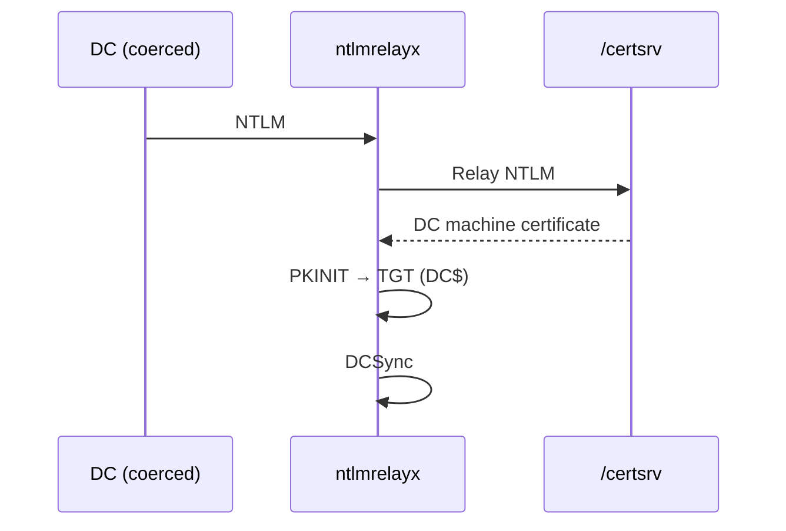

# ADCS ESC8 (NTLM relay to CA web enrollment)

### Affected object / attribute
**ADCS web-enrolment endpoint** (`/certsrv/`) — NTLM authentication.

### Concept (deep)
HTTP enrolment accepts **NTLM**. Coerce a DC/privileged machine and **relay** to the endpoint → **machine certificate** → **PKINIT** → DCSync rights.

### Attack flow (Mermaid)


### Commands
```bash
