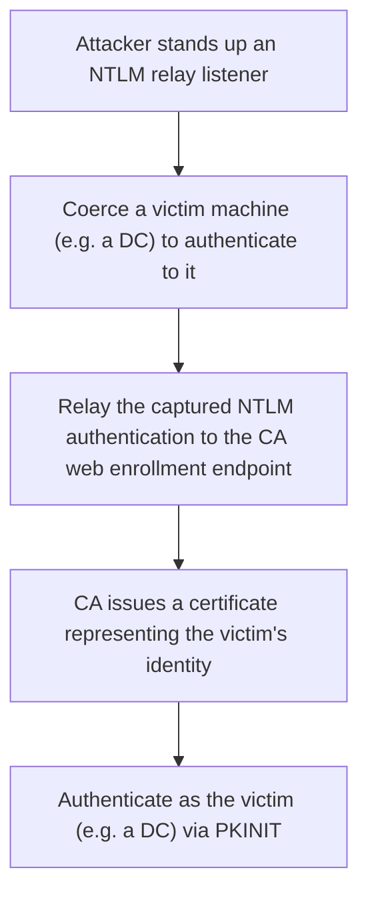
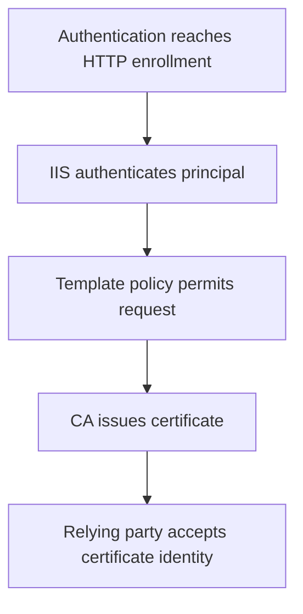

# ADCS ESC8 (NTLM relay to CA web enrollment)

ESC8 describes NTLM authentication relayed to an enterprise CA HTTP enrollment endpoint. Web enrollment normally permits authorized enrollment, but IIS authentication, endpoint binding and template policy must preserve the authenticated identity and prevent unintended issuance.

> **Authorized assessment only:** This guide is for controlled labs and explicitly authorized reviews. It provides no relay commands, coercion procedures or credential-reuse instructions.

## Beginner-friendly walkthrough

**In plain terms:** AD CS often exposes a web page (`certsrv`) for requesting certificates over
HTTP, and that web enrollment endpoint typically only supports NTLM authentication — which is
relayable. ESC8 coerces a victim machine (classically a domain controller) into authenticating
to an attacker-controlled listener, then relays that captured NTLM authentication straight to
the CA's web enrollment page, requesting a certificate *as the victim machine* without ever
knowing its password.

**Objects abused / affected**

| Object | Normal purpose | What ESC8 touches |
| --- | --- | --- |
| AD CS web enrollment endpoint (`certsrv`) | Lets users/machines request certificates over HTTP | Accepts NTLM authentication, which can be relayed instead of being supplied by the real owner |
| Coerced victim identity (often a DC's machine account) | Normally only authenticates to legitimate services | Tricked into authenticating to an attacker-controlled relay listener |
| Issued client-auth certificate | Represents the victim's identity | Obtained by the attacker via the relayed session, not the victim |



**Stages, and which tool typically covers each one**

1. **Coerce authentication** — this reuses the same coercion techniques as [unconstrained delegation abuse](unconstrained_deleg.md) (e.g. `PetitPotam`-style primitives) to make a victim machine authenticate somewhere the attacker controls.
2. **Relay to AD CS instead of capturing** — `Certipy`'s relay mode and `Impacket`'s relay tooling both support targeting the AD CS HTTP enrollment endpoint specifically as the relay destination.
3. **Why this is a top-tier finding** — if the coerced identity is a domain controller, the resulting certificate effectively grants domain-controller-equivalent authentication.

The direct fix is requiring Extended Protection for Authentication (EPA) and HTTPS with channel binding on the web enrollment endpoint — both close the relay, independent of any one template's configuration.

**Where exact command syntax lives:** this repo deliberately keeps technique pages
command-free (see `CONTRIBUTING.md`). For copy-pasteable enumeration/exploitation syntax for
this exact ESC, the authoritative public sources are the [Certipy Wiki](https://github.com/ly4k/Certipy/wiki)
(the tool that implements detection/abuse for ESC1–ESC17), [HackTricks' AD CS domain escalation page](https://book.hacktricks.xyz/windows-hardening/active-directory-methodology/ad-certificates/domain-escalation),
and the [SpecterOps "Certificates and Pwnage and Patches, Oh My!" post](https://specterops.io/blog/2022/11/09/certificates-and-pwnage-and-patches-oh-my) that introduced several later ESCs.


## AD CS and IIS objects

The enterprise CA, IIS web-enrollment virtual directories, HTTP/RPC enrollment services, IIS authentication settings, NTLM/EPA/channel binding, DNS/SPN identity, published `pKICertificateTemplate` objects, enrollment ACL, EKU and CA issuance policy form the relevant chain.

## Prerequisite chain

A reachable HTTP enrollment interface, an authentication/relay position authorized for the test, accepted NTLM at that interface, a published template with suitable enrollment rights and EKU, and downstream trust for the resulting certificate must all exist. Network reachability alone is not issuance or privilege.

## Affected objects and fix

```text
Objects: CA Web Enrollment endpoint, IIS authentication policy, and published templates
Settings to review: HTTPS, Extended Protection/channel binding, NTLM acceptance, enrollment ACLs
Risky state: Unnecessary endpoint accepts authentication without the required protections
Fix target: Disable unused endpoint; otherwise enforce supported protections and least privilege
```



## Impact limits

HTTPS, IIS authentication, Extended Protection/EPA and channel binding, NTLM restrictions, CA template publication and rights, approval, EKU and relying-party trust can stop or limit this chain. A relayed HTTP session is not proof of certificate issuance or account/control privilege.

## Detection and validation

Correlate IIS/HTTP enrollment access and NTLM authentication with CA 4886/4887, template, requester, source/destination host and issued certificate purpose. Review DNS/SPN and certificate-authentication events. Baseline normal certificate enrollment; do not alert solely for `/certsrv/` traffic.

## Mitigation and recovery

Disable unneeded web enrollment, require HTTPS and IIS Extended Protection/channel binding, disable or restrict NTLM relay paths, enable EPA, restrict template enrollment and remove unnecessary published templates. On suspicion, preserve IIS/CA evidence, revoke implicated certificates through an approved process, restore endpoint/authentication policy and revalidate in a lab.

## References

- [Microsoft: IIS Extended Protection](https://learn.microsoft.com/iis/configuration/system.webserver/security/authentication/extended-protection)
- [Microsoft: AD CS web enrollment](https://learn.microsoft.com/windows-server/identity/ad-cs/network-device-enrollment-service-overview)
- [Microsoft: AD CS overview](https://learn.microsoft.com/windows-server/identity/ad-cs/active-directory-certificate-services-overview)
- [MITRE ATT&CK: T1649](https://attack.mitre.org/techniques/T1649/)
