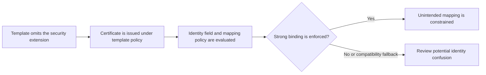

# AD CS ESC9: missing security extension

ESC9 describes a certificate template configured not to include the security extension that normally binds an issued certificate to a directory identity. The resulting risk depends on the certificate's identity fields and the relying party's certificate-mapping behavior.

> **Authorized assessment only:** Assess template flags and mapping policy without attempting identity substitution on production systems.

## Conceptual path

## Conditions and limits

An omitted extension is not sufficient by itself. Template enrollment, certificate identity, domain-controller mapping rules, patch state, strong-binding enforcement and relying-party behavior must align. Mapping policies have changed across Windows updates and can vary by deployment.

## Defensive review

Remove the template setting that suppresses the extension unless an approved compatibility need exists. Enforce current strong certificate binding, inventory exceptions and test affected applications in a lab before removing compatibility behavior.

## Detection

Inspect issued certificates and correlate template settings with certificate authentication events. Review template changes, CA issuance logs and domain-controller certificate-mapping events for unexpected identities or fallback behavior.

## References

- [AD CS ESC taxonomy overview](docs/techniques/adcs_esc_matrix.md)
- [Microsoft: KB5014754 certificate-based authentication changes](https://support.microsoft.com/kb/5014754)
- [MITRE ATT&CK: T1649](https://attack.mitre.org/techniques/T1649/)
