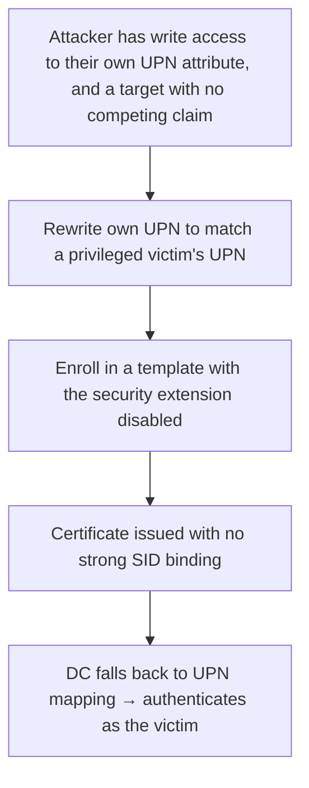
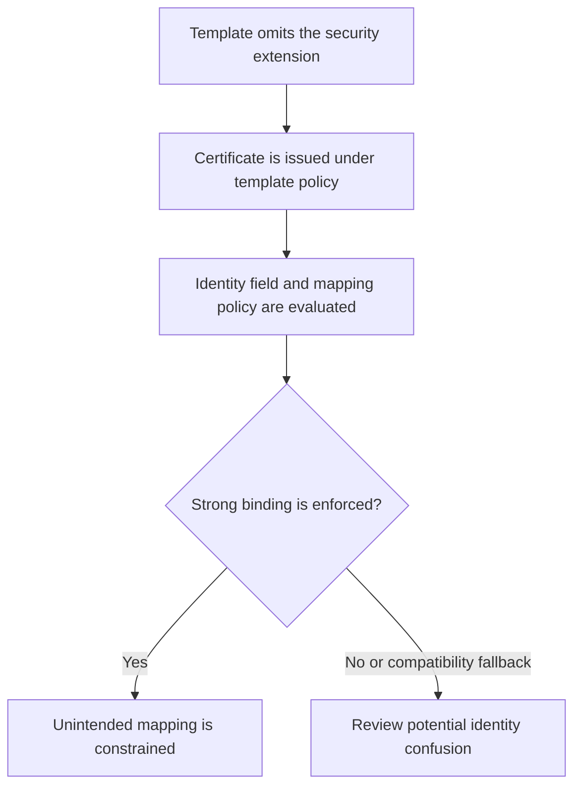

# AD CS ESC9: missing security extension

ESC9 describes a certificate template configured not to include the security extension that normally binds an issued certificate to a directory identity. The resulting risk depends on the certificate's identity fields and the relying party's certificate-mapping behavior.

> **Authorized assessment only:** Assess template flags and mapping policy without attempting identity substitution on production systems.

## Beginner-friendly walkthrough

**In plain terms:** since 2022, a well-configured certificate embeds a strong binding extension
(the "security extension") that ties it unambiguously to one AD account by SID, so a certificate
can't be confused for a different account even if other identity fields overlap. ESC9 is a
template configured to *skip* that extension. Combined with a separate write right over another
account's `userPrincipalName` attribute, an attacker can briefly rewrite a victim's UPN to match
their own, enroll for themselves, and get a certificate that — without the missing SID
extension to disambiguate — authenticates as the victim.

**Objects abused / affected**

| Object | Normal purpose | What ESC9 touches |
| --- | --- | --- |
| `CT_FLAG_NO_SECURITY_EXTENSION` on a template | Opt-out introduced for narrow compatibility cases | Removes the strong SID-binding extension from certificates that template issues |
| Target account's `userPrincipalName` | Normally stable and unique | Temporarily rewritten by the attacker (requires a separate write right, e.g. via [ACL abuse](acl_abuse.md)) to match the attacker's own UPN |
| Weak certificate mapping on the DC | Falls back to UPN-based matching when the strong extension is absent | What actually lets the spoofed UPN resolve to the victim account |



**Stages, and which tool typically covers each one**

1. **Find the template flag and the UPN write right** — `Certipy` flags `CT_FLAG_NO_SECURITY_EXTENSION` directly, and the UPN write right is found the same way any [ACL abuse](acl_abuse.md) edge is found.
2. **Rewrite and enroll** — `Certipy`'s account-update functionality and standard enrollment both apply here in sequence.
3. **Why patch status matters** — Microsoft's May 2022 update (the "Certifried" / CVE-2022-26923 fix) introduced the strong-mapping behavior this technique tries to route around; an unpatched or soft-enforcement-mode environment is far more exposed.

**Where exact command syntax lives:** this repo deliberately keeps technique pages
command-free (see `CONTRIBUTING.md`). For copy-pasteable enumeration/exploitation syntax for
this exact ESC, the authoritative public sources are the [Certipy Wiki](https://github.com/ly4k/Certipy/wiki)
(the tool that implements detection/abuse for ESC1–ESC17), [HackTricks' AD CS domain escalation page](https://book.hacktricks.xyz/windows-hardening/active-directory-methodology/ad-certificates/domain-escalation),
and the [SpecterOps "Certificates and Pwnage and Patches, Oh My!" post](https://specterops.io/blog/2022/11/09/certificates-and-pwnage-and-patches-oh-my) that introduced several later ESCs.


## Conceptual path



## Conditions and limits

An omitted extension is not sufficient by itself. Template enrollment, certificate identity, domain-controller mapping rules, patch state, strong-binding enforcement and relying-party behavior must align. Mapping policies have changed across Windows updates and can vary by deployment.

## Affected object and fix

```text
Object: pKICertificateTemplate
Setting to review: msPKI-Enrollment-Flag and CT_FLAG_NO_SECURITY_EXTENSION behavior
Risky state: Authentication certificate is issued without the expected identity-binding extension
Fix target: Include the security extension and enforce current strong certificate mapping
```

## Defensive review

Remove the template setting that suppresses the extension unless an approved compatibility need exists. Enforce current strong certificate binding, inventory exceptions and test affected applications in a lab before removing compatibility behavior.

## Detection

Inspect issued certificates and correlate template settings with certificate authentication events. Review template changes, CA issuance logs and domain-controller certificate-mapping events for unexpected identities or fallback behavior.

## References

- [AD CS ESC taxonomy overview](docs/techniques/adcs_esc_matrix.md)
- [Microsoft: KB5014754 certificate-based authentication changes](https://support.microsoft.com/kb/5014754)
- [MITRE ATT&CK: T1649](https://attack.mitre.org/techniques/T1649/)
