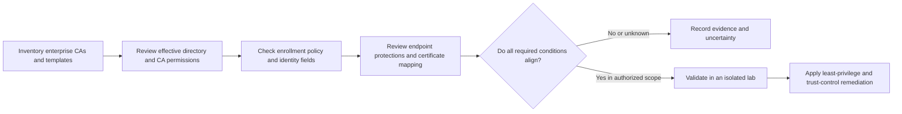

# AD CS ESC taxonomy overview

The ESC labels are a commonly used taxonomy for Active Directory Certificate Services (AD CS) misconfiguration and certificate-trust paths. This page summarizes ESC1–ESC16, covering template policy, directory permissions, CA permissions, enrollment endpoints, private-key protection, and certificate-to-account mapping. Taxonomy versions can add or revise labels; a scanner label is a lead to validate—not proof of issuance, impersonation, or privilege.

> **Authorized assessment only:** Use these categories to structure read-only review and defensive validation. Do not request certificates, relay authentication, alter CA/template state, or test real identities unless the owner has explicitly approved that exact action.

## Assessment path

## ESC categories

| Label | Failure family | Defensive assessment question |
| --- | --- | --- |
| ESC1 | A broadly enrollable template combines requester-influenced identity fields with an authentication-capable purpose. | Are subject/SAN fields directory-derived, are enrollment rights narrowly scoped, and are approval/signature controls enforced? |
| ESC2 | A template permits a broad or absent EKU/application policy. | Is every issued purpose explicitly required, and can the resulting certificate be used for authentication by relying parties? |
| ESC3 | Enrollment-agent policy and permissions permit one principal to request certificates on behalf of another. | Are enrollment-agent rights, target templates, signatures, and approval restricted to documented workflows? |
| ESC4 | A principal that should not control issuance can modify a certificate template. | Who has effective write/owner/DACL rights after inheritance and nested-group resolution? |
| ESC5 | A principal can modify a security-relevant PKI object, such as a CA, OID, NTAuth-related object, or other trusted configuration. | Are PKI object ACLs restricted to tiered PKI administrators and monitored for changes? |
| ESC6 | CA-wide policy accepts requester-supplied subject alternative names under conditions where identity should be controlled by the directory. | Is the CA-wide SAN behavior required, and are authentication templates and issuance policy independently constrained? |
| ESC7 | CA management or certificate-manager permissions are broader than the intended PKI roles. | Who can manage CA configuration, approve/deny requests, or change issuance state, and are those roles audited? |
| ESC8 | An inadequately protected HTTP enrollment endpoint may accept relayed NTLM authentication. | Are web enrollment and related endpoints necessary, HTTPS-only, and protected with Extended Protection/channel binding and appropriate NTLM controls? |
| ESC9 | A template configuration omits the certificate security extension used in strong account binding. | Are templates and relying-party mapping policy configured so issued certificates retain strong identity binding? |
| ESC10 | Weak certificate-mapping policy on domain controllers can permit a certificate to map to an unintended account in specific configurations. | Are strong certificate bindings enforced and current, and are fallback/compatibility mapping settings understood and minimized? |
| ESC11 | An RPC enrollment interface may lack the required packet-privacy protection, creating a relay exposure under specific network and authentication conditions. | Is RPC enrollment required, and does it enforce packet privacy and the intended authentication protections? |
| ESC12 | The CA signing private key is exposed or insufficiently protected. | Is the key held by an appropriate HSM/TPM or equivalent control, non-exportable where feasible, and access-audited? |
| ESC13 | An issuance-policy OID is linked to a privileged group in a way that can affect authorization when a certificate is accepted. | Are OID-to-group links necessary, tightly governed, and reviewed together with relying-party authorization? |
| ESC14 | Explicit certificate-to-account mappings are weak or controlled by principals that should not manage identity bindings. | Are `altSecurityIdentities` mappings strong, uniquely bound, and writable only by trusted identity administrators? |
| ESC15 | Legacy schema-version-1 template behavior may allow an application policy to be supplied in a way that changes certificate purpose. | Are legacy templates still needed, and can they be replaced with current schema and constrained application policies? |
| ESC16 | CA configuration suppresses the security extension used for strong certificate-to-account binding. | Is the CA security extension enabled, and are certificate mapping and compatibility exceptions reviewed across all issuing CAs? |

These are screening categories, not a single exploit chain. Applicability depends on Windows/CA versions, effective permissions, template publication, approval and signature policy, network reachability, certificate trust, mapping behavior, and the relying party. The current Certipy wiki index also lists ESC17; its definition is not included here because it was not independently verified for this update. Confirm the current taxonomy and behavior against vendor documentation and a controlled lab before treating this matrix as exhaustive.

## Safe validation and reporting

1. Establish the assessed domain, CAs, principal, time window, approved collection methods, and actions that are explicitly out of scope.
2. Record object distinguished names, effective permissions, template publication, CA and endpoint settings, and relevant patch/configuration state.
3. Separate confirmed facts from hypotheses. A static finding is not confirmed impact unless every prerequisite and relying-party behavior is established.
4. Prefer non-destructive validation. Any issuance, identity substitution, relay, or configuration change requires separate written approval and an isolated or owner-designated lab.
5. Report affected objects, business purpose, evidence, uncertainty, remediation owner, rollback plan, and a way to verify the corrected path.

## Defensive priorities

- Restrict enrollment, template modification, CA administration, certificate approval, and PKI-object write rights to documented roles.
- Remove unused templates and enrollment endpoints; prefer directory-derived identity for authentication certificates.
- Enforce strong certificate mapping and current security extensions; review compatibility exceptions rather than relying on them indefinitely.
- Protect CA hosts and signing keys as Tier-0 assets. Monitor template, CA, OID, mapping, endpoint, and key-access changes.
- Correlate directory audit, CA request/issuance, IIS/RPC enrollment, certificate authentication, and relying-party logs.

## Practice lab

- [Hack The Box: Certified](https://app.hackthebox.com/machines/Certified) provides a retired AD certificate-services practice environment for selected certificate-mapping and template concepts. It does not represent every ESC category.
- Follow the platform's rules and keep all testing inside the assigned lab. Do not use lab credentials, data, or procedures against a real organization.

## References

- [Microsoft: Active Directory Certificate Services overview](https://learn.microsoft.com/windows-server/identity/ad-cs/active-directory-certificate-services-overview)
- [Microsoft: Certificate template concepts](https://learn.microsoft.com/windows-server/identity/ad-cs/certificate-template-concepts)
- [Microsoft: KB5014754 certificate-based authentication changes](https://support.microsoft.com/kb/5014754)
- [SpecterOps: Certified Pre-Owned](https://specterops.io/wp-content/uploads/sites/3/2022/06/Certified_Pre-Owned.pdf)
- [Certipy project](https://github.com/ly4k/Certipy)
- [MITRE ATT&CK: T1649](https://attack.mitre.org/techniques/T1649/)
