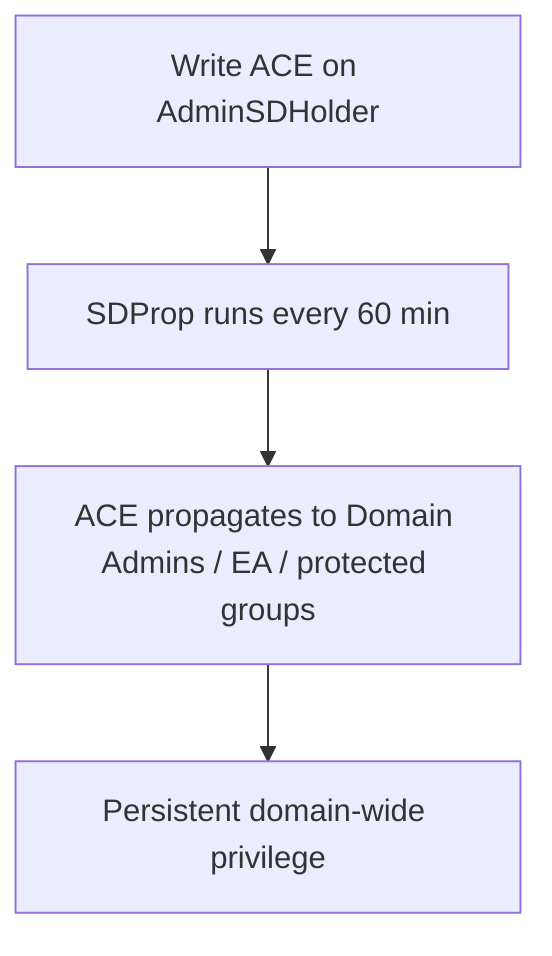

# AdminSDHolder / SDProp persistence

### Affected object / attribute
**`CN=AdminSDHolder,CN=System,DC=...`** — `nTSecurityDescriptor`.

### Concept (deep)
**SDProp** (every 60 minutes) copies the AdminSDHolder ACL to all **protected accounts and groups** (`adminCount=1`). Adding an ACE here is **quiet, durable persistence** across DA resets.

### Attack flow (Mermaid)


### Commands
```bash
