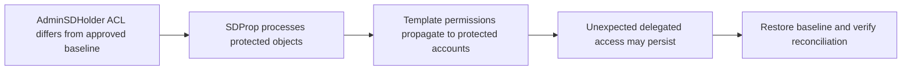

# AdminSDHolder / SDProp persistence

Active Directory uses the AdminSDHolder object as a security-descriptor template for protected accounts and groups. The SDProp process periodically reconciles those objects with the template. An unauthorized change to the AdminSDHolder ACL can therefore cause a permission change to reappear on protected objects after ordinary remediation.

> **Authorized assessment only:** Compare directory ACLs read-only. Do not change AdminSDHolder or protected-account permissions as a test.

## Conceptual path

## Conditions and limits

The affected account must be in the protected set and SDProp must process it. A changed ACL does not automatically grant useful access; identify the specific right, affected object and resulting authorization. Replication and processing timing can make observations differ between domain controllers.

## Defensive review

Restrict writes to AdminSDHolder and protected-object ACLs to tiered directory administrators. Compare the template against a known-good baseline, review protected-group membership and ensure remediation includes both the template and any already-affected objects.

## Detection and recovery

Audit changes to AdminSDHolder's owner and DACL, then monitor protected-account descriptors for unexpected reapplication. Preserve directory replication and audit evidence; restore the approved ACL and verify after SDProp has run on the relevant domain controllers.

## References

- [Microsoft: Protected accounts and groups in Active Directory](https://learn.microsoft.com/en-us/windows-server/identity/ad-ds/plan/security-best-practices/appendix-c--protected-accounts-and-groups-in-active-directory)
- [MITRE ATT&CK: Account Manipulation](https://attack.mitre.org/techniques/T1098/)
