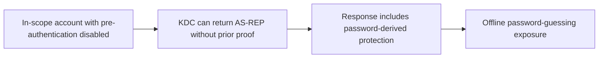

# AS-REP roasting

## Concept

Kerberos pre-authentication normally requires a client to demonstrate knowledge of its secret before the Key Distribution Center (KDC) returns the account’s initial authentication response. An account configured with the `DONT_REQ_PREAUTH` setting is an exception: the KDC can return an AS-REP without that proof. Part of the response is protected using key material derived from the account’s password, so an observer may be able to test password guesses offline.

This is distinct from Kerberoasting: it concerns the initial AS exchange and accounts that do not require pre-authentication, rather than service tickets associated with SPNs. It does not mean the password is disclosed in plaintext, nor that every such account can be cracked. Success depends on password strength and available guessing resources.

## Prerequisites and affected objects

A review needs visibility into user-account flags and the organization’s documented exceptions. A vulnerable configuration is an account that does not require Kerberos pre-authentication, particularly if it is privileged, reused, service-related, or protected by a weak or old password. Assessment should establish the flag, business justification, account owner, privileges, password-management method, and whether the account remains active.

The presence of the setting alone does not establish recoverability or account compromise. Offline guessing creates no repeated online password attempts, so ordinary lockout controls do not prevent that phase; however, a strong independently generated secret can make guessing infeasible.

## Detection

Review Event 4768 (TGT request) and its pre-authentication-related fields, looking for requests associated with accounts configured to bypass pre-authentication and for unusual request patterns or sources. Interpret fields with the relevant Windows version and event schema; a simple absent-value rule can be misleading. Correlate with account inventory and expected client behavior.

## Remediation

Enable Kerberos pre-authentication unless a documented compatibility requirement justifies an exception. For exceptions, use long, random, uniquely managed passwords; minimize privileges; monitor use; and establish an owner and review date. Disable or retire unnecessary accounts and investigate any evidence that password material may have been recovered. See [Kerberoasting](kerberoast.md) for a related but distinct Kerberos exposure.

## Limits

This page describes risk assessment and defensive validation only. It does not provide a workflow for collecting AS-REP material or attempting password recovery. Results from an authorized review should be reported as configuration exposure unless evidence supports a stronger conclusion.
