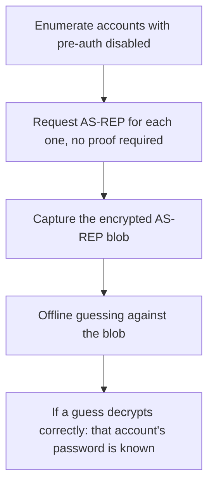

# AS-REP roasting

Kerberos pre-authentication normally requires the account key before the KDC issues an AS-REP. The AS-REP roasting hypothesis applies only to accounts configured not to require it.

> **Authorized assessment only:** This guide describes controlled, explicitly authorized assessment and defensive validation. It contains no target commands, exploit recipes, payloads, guessing parameters or real-target procedure.

## Beginner-friendly walkthrough

**In plain terms:** normally, logging into a Kerberos domain requires you to first "prove" who you are with a password-derived key before the server will hand you a ticket. A small number of accounts are configured to skip that proof step. For those accounts, anyone can simply ask for a ticket, and the response is encrypted with a key derived from that account's password — which can then be checked offline against a wordlist, exactly like checking a lock against a set of keys at home instead of at the door.

**Objects abused / affected**

| Object | Normal purpose | What this technique touches |
| --- | --- | --- |
| `userAccountControl` flag `DONT_REQ_PREAUTH` | Legacy compatibility setting on some accounts | Its presence is what makes an account "roastable" at all |
| AS-REP (initial Kerberos reply) | Normally only issued after proof of the password | Issued without proof for flagged accounts, encrypted with that account's key |
| Account password | Authentication secret | What an attacker is trying to recover via offline guessing |



**Stages, and which tool typically covers each one**

1. **Find the candidates** — `PowerView`/LDAP recon identifies accounts with `DONT_REQ_PREAUTH` set (surfaced in the recon phase above).
2. **Request the material** — `Rubeus` (Windows) or `Impacket`'s relevant script (cross-platform) requests the AS-REP for each candidate account; no valid credential is required to do this for a flagged account.
3. **Offline recovery** — `hashcat` runs the actual guessing work against the captured material, completely offline and with no further contact to the domain.

Reference shape of the flag being checked for (not a live query):

```text
userAccountControl: 0x410200   # includes DONT_REQ_PREAUTH
```

The fix is simple and permanent: clear that flag unless there is a specific, documented legacy reason for it, and use a long random password or a managed service account instead.


## Relevant objects and normal purpose

The relevant account flags (`DONT_REQ_PREAUTH`/`UF_DONT_REQUIRE_PREAUTH`), sAMAccountName/UPN, supported ticket encryption types, KDC, AS-REP, account password and account privilege/reuse are the core evidence.

## Prerequisite chain

An account with pre-authentication disabled must be visible to the KDC and return AS-REP material. Offline recovery depends on password strength and ticket encryption; no password guessing is described here.


## Impact limits and failure cases

A weak or reused password has greater impact, but a strong password or unprivileged account may yield no practical privilege. Account lockout does not prevent offline verification after AS-REP material exists.

## Detection and validation

Review 4768 AS exchanges and pre-authentication failures, account UAC/flag changes, and later use of the account. Baseline normal legacy accounts and correlate 4768 with the KDC, source and target account.

Validate an impact hypothesis by correlating the relevant identity, directory, authentication, endpoint, network or cloud telemetry for the exact host, account and time. One event ID or tool label is not proof of success.

## Mitigation and recovery

**Mitigation:** Remove pre-authentication exemptions except for documented compatibility, enforce strong unique passwords and AES as compatible, restrict account privilege, and rotate exposed secrets.

**Recovery:** Preserve evidence, isolate affected systems and identities, remove unauthorized state through approved procedures, review relevant credentials/sessions and retest in a clean lab.

## References

- [Microsoft: Kerberos authentication overview](https://learn.microsoft.com/windows-server/security/kerberos/kerberos-authentication-overview)
- [Microsoft: Credential protection](https://learn.microsoft.com/windows-server/security/credentials-protection-and-management/credential-protection-and-management)
- [MITRE ATT&CK: T1558.004](https://attack.mitre.org/techniques/T1558/004/)
