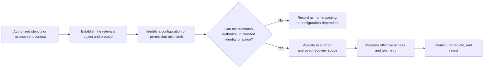

# Certighost

This page discusses the CVE-2026-54121 hypothesis only at the level supported by the current public summary. NVD describes it as improper authorization in Active Directory Certificate Services that could permit an authorized network actor to elevate privileges. The summary does not establish a specific enrollment fallback, a DC identity, or a CA-coercion mechanism.

## CVE summary versus technique hypothesis

| Source | What is known |
| --- | --- |
| NVD | CVE-2026-54121 is described as improper authorization in AD CS allowing authorized network privilege escalation. |
| Microsoft advisory | Use the MSRC advisory below as the vendor record for affected components, versions, prerequisites, mitigations, and any implementation detail. |
| This page | It is a bounded hypothesis for reviewing AD CS authorization boundaries. It does not assert that a low-privileged requester obtains a DC identity or that a certificate CA-coercion/fallback path exists. |

> **Authorized assessment only:** This guide describes assessment concepts and defensive validation for controlled, explicitly authorized environments. It does not provide target commands, exploit recipes, credential-guessing parameters, or step-by-step attack instructions.

## Relevant objects and normal purpose

AD CS enterprise CAs and web/RPC enrollment surfaces, certificate templates and issuance policies, requester identity, CA authorization, certificate trust, and issuance audit data.

Normally, these components perform directory lookup, authentication, authorization, certificate issuance, remote administration, or credential protection. A risk hypothesis should preserve this normal use and identify the narrow departure that would create unintended control.

| Review item | Normal role | What to validate |
| --- | --- | --- |
| Identity or account | Represents the requesting, delegated, or target security principal | Scope, group membership, SID, account state, MFA or authentication policy, and administrative tier |
| Directory or policy object | Stores configuration and authorization | Object type, attributes, ACL/owner, replication state, and documented business purpose |
| Protocol or service | Moves authentication or management information | Endpoint, signing/encryption, channel binding, version, patch state, and whether it is required |
| Resulting credential or ticket | Authorizes a bounded operation | Lifetime, purpose/EKU/SPN, issuer or KDC, target audience, and revocation or rotation behavior |

## Prerequisites and scope

A Windows AD CS environment that is within the CVE's affected version range according to the authoritative Microsoft advisory, plus explicitly authorized access to the relevant CA or network interface.

**Typical prerequisites**

- Written authorization covering the identities, hosts, domains or tenants, data, and time window.
- A scoped account or lab artifact that exercises the relevant object or protocol without affecting unrelated systems.
- Visibility into directory state, authentication, endpoint, and audit telemetry sufficient to distinguish the hypothesis from normal administration.
- A recovery or rollback owner and approval for any configuration change or cleanup.

**Prerequisites should be confirmed rather than inferred.** Exact Windows Server/AD CS build and patch state, whether the Microsoft advisory applies, interface exposure, CA authorization, requester rights, template/EKU policy, and approved network scope.

## Conceptual attack chain

The chain is conceptual: discovery establishes the object and normal trust relationship; a controlled validation establishes whether configuration and effective access preserve that trust; and impact is measured by the action or identity that a permitted principal can actually obtain. Stop at a negative or inconclusive result, and do not attempt to expand scope based on a tool label alone.

## Conditions and limits affecting impact

This is a configuration/version-sensitive weakness. The CVE summary does not substantiate DC-identity issuance or a specific AD CS coercion/fallback technique; either of those would require separate, directly applicable vendor or engineering evidence.

Other conditions frequently alter the result:

- **Patch and version:** Verify the exact OS, application, DC, CA, Entra, or protocol implementation. Vendor changes and security updates may remove a historical condition.
- **Scope:** Domain, forest, tenant, application, device, network segment, and resource authorization can narrow or broaden the effect.
- **Identity state:** Disabled accounts, expired credentials, Protected Users, authentication policies, account restrictions, and MFA may invalidate a theoretical path.
- **Cryptographic state:** Ticket/credential lifetime, key rotation, revocation, trust chains, certificates, and key protection are separate from directory permissions.
- **Telemetry completeness:** Missing or delayed logs do not prove absence; correlate identity, directory, endpoint, network, and application records.

## Defensive validation

Use independent checks rather than relying on a single alert or tool result:

1. Confirm that the object or protocol is present, required, and owned by a documented business role.
2. Resolve effective ACL, group, role, device, tenant, or service permissions, including inherited and nested rights.
3. Verify the configuration against the exact host, DC, CA, application, or tenant version in scope.
4. Attempt only approved read-only or lab-safe validation. Compare the observed identity and resulting privilege with policy.
5. Correlate the result with audit, authentication, directory, endpoint, network, and application telemetry.

The existing page-level telemetry note is: **Certificate request carrying a DC identity from a low-privileged requester.** It is legacy graph metadata and is not evidence for CVE-2026-54121. It should not be used as the CVE detection rule. Prefer correlated CA request/issuance, authorization, template, directory, identity, and certificate-authentication telemetry.

### Useful telemetry

| Source | Examples to correlate |
| --- | --- |
| Directory or identity audit | Object reads or writes, ACL/attribute changes, role changes, trust or credential configuration, and successful/failed sign-ins |
| Authentication/KDC or cloud sign-in | Account and source, protocol, KDC/DC or tenant, target SPN/resource, certificate or MFA method, and policy evaluation |
| Endpoint and process telemetry | Security process access, service or WMI activity, scheduled tasks, registry/hive access, remote-management sessions, and memory/integrity alerts |
| Network and DNS | SMB/RPC/LDAP/Kerberos/NTLM/HTTP/DNS flows, loopback or relay patterns, unusual source relationships, and destination endpoints |
| Certificate or key infrastructure | Request and issuance records, template use, key use, CRL/OCSP state, enrollment changes, and relying-party authentication failures |

Baseline the source, host, account, time, and expected administrative workflow before calling a sequence anomalous. A one-event match can be noisy or version-dependent.

## Mitigation and recovery

- Apply least privilege to directory objects, service identities, hosts, delegation relationships, CA templates, cloud roles, and local administrator groups.
- Keep systems supported and patched; use the vendor’s current security guidance and test mitigations for compatibility before broad deployment.
- Enforce strong authentication and administrative separation, including tiered administration, MFA/Conditional Access, Protected Users or equivalent policies, and credential isolation where appropriate.
- Restrict protocol and management surfaces by firewall, signing/channel binding, endpoint policy, and network segmentation. Remove unused templates, services, shares, subscriptions, or trust features.
- Centralize and retain identity, directory, endpoint, CA, DNS, and cloud logs. Alert on correlated state changes and abnormal effective access rather than isolated event IDs.

For suspected compromise, preserve evidence, isolate affected hosts or identities, revoke sessions and relevant credentials, rotate only with an approved incident plan, and verify replication and cache propagation. Some secrets require two-stage rotation or cross-domain/tenant cleanup because old keys, tickets, or credentials may remain effective until they expire or are replaced. Reassess with a clean or restricted test identity after recovery.

## Tools and validation discipline

The graph metadata identifies ["certipy"]. These are dual-use tools; use only read-only or lab-safe workflows for the authorized scope.

No commands or payloads are provided on this page. Prefer vendor-supported inventories, directory queries in read-only mode, and purpose-built lab replicas for proof. Where the graph marks a tool, confirm that its collection mode is authorized and interpret its findings against live configuration.

## References

- [MITRE ATT&CK: T1649](https://attack.mitre.org/)

- [NVD: CVE-2026-54121](https://nvd.nist.gov/vuln/detail/CVE-2026-54121)
- [Microsoft Security Update Guide: CVE-2026-54121](https://msrc.microsoft.com/update-guide/vulnerability/CVE-2026-54121)
- [Microsoft: AD CS overview](https://learn.microsoft.com/en-us/windows-server/identity/ad-cs/active-directory-certificate-services-overview)
- [Microsoft: Certificate templates](https://learn.microsoft.com/en-us/windows-server/identity/ad-cs/certificate-template-concepts)
- [MITRE ATT&CK mapping](https://attack.mitre.org/techniques/1649/)

## Reporting checklist

- Exact environment, OS/DC/CA/tenant versions, domain or tenant scope, and assessment window.
- Objects and effective principals involved, with object distinguished names or resource IDs.
- Configuration values and the normal business purpose for each permission or protocol.
- Preconditions that were confirmed, rejected, or not testable.
- Observed impact, effective identity or privilege, and affected resource scope.
- Relevant directory, authentication, endpoint, network, certificate, and cloud telemetry.
- Remediation owner, rollback/rotation requirements, and verification criteria.
