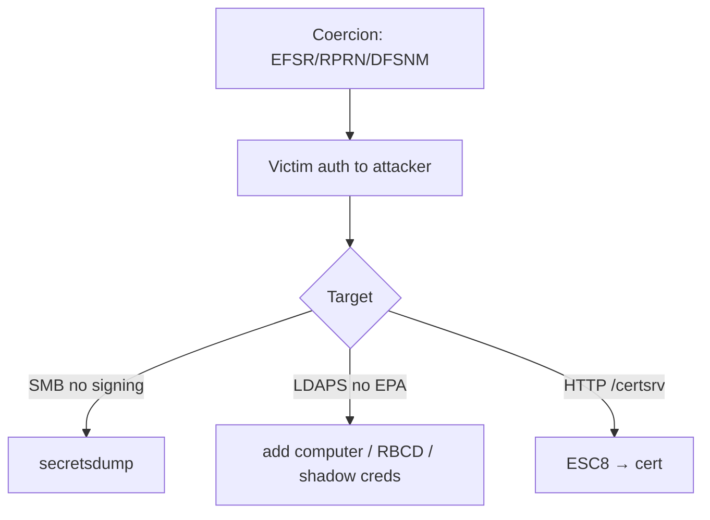

# Coerced authentication → NTLM relay

### Affected object / attribute
**Authentication coercion** (EFSRPC, RPRN, DFSNM) + **relay target** (SMB/LDAPS/HTTP).

### Concept (deep)
Force a privileged principal to authenticate to you, then **relay** that auth to a target without signing/EPA. Coercion catalogue: **EFSRPC (PetitPotam)**, **RPRN (PrinterBug)**, **DFSNM (DFSCoerce)**, **ShadowCoerce**, **MSEven**.

### Attack flow (Mermaid)


### Exhaustive commands
```bash
