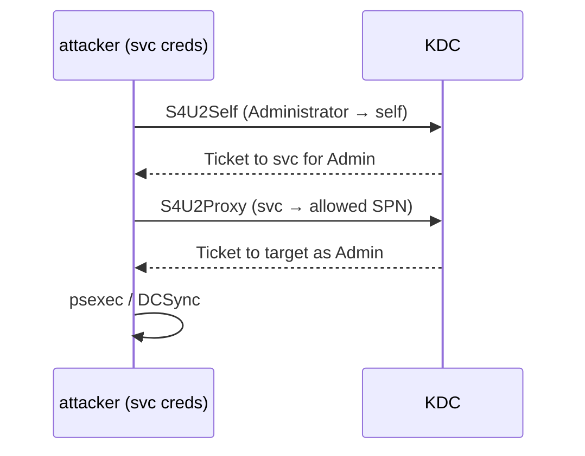

# Constrained delegation abuse (S4U2Self/S4U2Proxy)

### Affected object / attribute
**`msDS-AllowedToDelegateTo`** on a service account, plus **`TRUSTED_TO_AUTH_FOR_DELEGATION`**.

### Concept (deep)
The service is restricted to specific SPNs. With **protocol transition**, the service can obtain a ticket **to itself on behalf of any user** (**S4U2Self**), then **S4U2Proxy** to obtain a ticket to the delegated SPN as that user. Compromising the service account → impersonate DA to the allowed service.

### Attack flow (Mermaid)


### Exhaustive commands
```bash
