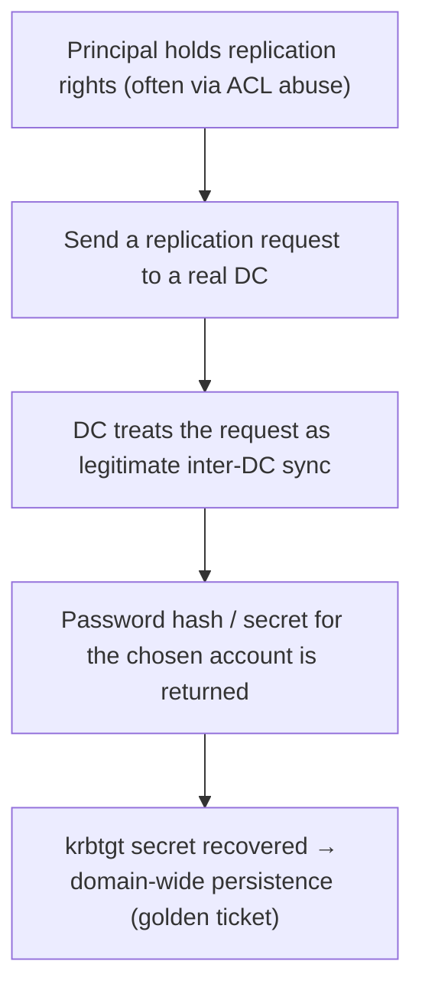

# DCSync

DCSync is the use of Microsoft Directory Replication Service Remote Protocol (MS-DRSR) operations to request directory state as a replica. The security-sensitive case is when a non-domain-controller identity has effective rights to replicate password-verification or credential data.

> **Authorized assessment only:** This guide is for controlled labs and explicitly authorized assessments. It contains no commands, exploit procedure or real-target instructions.

## Beginner-friendly walkthrough

**In plain terms:** domain controllers normally replicate password data *to each other* using a special replication protocol — it's how a second DC stays in sync with the first. DCSync abuses the fact that the protocol itself doesn't check "are you actually a domain controller," only "do you hold the replication right." An account with that right can pretend to be a DC for a moment and ask the real DC to replicate a chosen account's secrets straight to it.

**Objects abused / affected**

| Object | Normal purpose | What this technique touches |
| --- | --- | --- |
| `DS-Replication-Get-Changes` / `-All` extended rights | Let real DCs replicate directory data to each other | If granted to a non-DC principal, that principal can request the same replication |
| `krbtgt` account secret | Signs every Kerberos TGT in the domain | The single highest-value target: recovering it enables [golden tickets](golden.md) |
| Any user/computer account secret | Normal credential | Can be requested individually without touching that account's live session |



**Stages, and which tool typically covers each one**

1. **Get the right** — this almost always follows [ACL abuse](acl_abuse.md) or an existing Domain Admin-equivalent membership; DCSync is rarely the first step in a chain.
2. **Request the secret** — `Mimikatz`'s `lsadump` functionality and `Impacket`'s replication-focused script both speak MS-DRSR well enough to make this request look like ordinary replication traffic.
3. **Use the output** — a recovered `krbtgt` hash leads directly to [golden ticket](golden.md) forgery; any other recovered account hash can be used for [pass-the-hash](pth.md).

Reference shape of the rights being checked for on the domain object itself (not a live query):

```text
ACE: Allow  CORP\svc-backup  DS-Replication-Get-Changes-All
```

Very few accounts legitimately need that right — real DCs already have it implicitly. Anything else holding it is worth investigating immediately.


## Protocol and objects

MS-DRSR normally synchronizes Active Directory naming-context data among DCs over RPC. A DC replica is identified and authenticated, then requests changed objects and replication metadata.

| Object or right | Normal purpose | Assessment point |
| --- | --- | --- |
| Domain naming context | Contains the domain’s users, computers, groups and credential metadata | Define the exact domain NC and account scope |
| Replicate Directory Changes | Allows replication of general NC changes | Confirm effective ACL/ACE scope, inheritance and nested groups |
| Replicate Directory Changes All | Allows the complete class of directory replication used for secret-bearing data | A separate right may be required beyond ordinary LDAP read and general replication |
| Replicate Directory Changes in Filtered Set | Supports RODC-filtered replication contexts | It does not automatically grant full domain credential scope |
| DC/RODC and source principal | Normal DC replicas authenticate and synchronize as DC identities | A non-DC source is anomalous unless it is an approved backup or replication service |
| NTDS and credential fields | Supplies password-verification data, key history or related secret state where permitted | Determine account scope and whether material is current and usable |

Resolve the effective DACL on the domain NC rather than relying on group membership alone. Explicit or inherited ACEs, group nesting, deny rules and RODC filtering affect whether DRS accepts the request.

## Conceptual input and result

The conceptual input is an authenticated identity with effective replication rights plus access to a DC that exposes the target naming context. The conceptual result is replicated object and, in a sufficiently authorized DC-context, secret-bearing state for accounts in that NC.

The result may include krbtgt, user, computer or service-account verification material, but that is not equivalent to domain-wide administrative control. Derived impact depends on account type and privilege, key/credential state, and whether the material remains usable for Kerberos, NTLM or service authentication.

## Prerequisite chain

1. The principal needs effective replication rights for the target domain NC.
2. MS-DRSR network/RPC access to a writable DC must succeed.
3. The DC must expose the NC and replication operation to that identity.
4. The requested secret or object state must remain valid or useful in the target domain/account scope.
5. The assessment must show a meaningful account or privilege consequence; replication metadata alone is insufficient.

Child-domain, forest, RODC and filtered-attribute scope can be narrower than the parent domain or all forest identities.

## Failure cases and impact limits

- LDAP read access or domain membership does not provide DRS rights.
- A replication right in one NC does not automatically apply to another domain or forest NC.
- An RODC or filtered-attribute policy may omit credential fields.
- An NT hash or key history may be stale after password reset or key rotation.
- Extracted material may be unusable for protected accounts, modern credential controls or a specific host/service.
- The DC may reject the source or network policy; RPC restrictions, DC patch state and replication ACL changes can alter behavior.
- Replication access proves data visibility, not necessarily krbtgt theft, resource authorization or lateral access.

## Detection and validation

Event 4662 is a starting signal if it records a domain-NC replication control GUID/access mask from a non-DC source. Correlate the requesting account and source host with the target DC, naming context, DRS RPC activity and DC Directory Service audit events.

Independently verify effective DRS ACEs and nested groups, confirm whether the source is a real DC/RODC or approved replication service, and review later account use such as 4624/4776 or 4768/4769. 4662 alone can be noisy for normal DC replication or backups; topology and source identity matter.

## Mitigation and recovery

Remove DRS rights from non-DC identities, review domain-NC ACL inheritance and Tier-0 membership, restrict DC management/RPC network access, and alert on new replication rights or unrecognized DC/replication sources. Keep RODC filtered-attribute policy aligned with the host’s documented need.

After suspected compromise, preserve DC and audit evidence, isolate the source identity/host and revoke unauthorized rights. Determine the naming context and accounts exposed. If krbtgt or other sensitive credentials are affected, use Microsoft’s staged incident recovery procedure, account for DC replication and review subsequent tickets, sessions and Tier-0 membership. Revalidate replication topology and clean source hosts before closure.

## References

- [Microsoft: MS-DRSR protocol overview](https://learn.microsoft.com/openspecs/windows_protocols/ms-drsr/)
- [Microsoft: Active Directory replication concepts](https://learn.microsoft.com/windows-server/identity/ad-ds/plan/active-directory-replication-concepts)
- [Microsoft: krbtgt password reset guidance](https://learn.microsoft.com/troubleshoot/windows-server/active-directory/krbtgt-password-reset)
- [MITRE ATT&CK: T1003.006](https://attack.mitre.org/techniques/T1003/006/)
