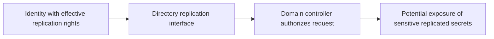

# DCSync

## Concept

Domain controllers replicate directory data using the Directory Replication Service Remote Protocol (DRSR). DCSync refers to abuse of directory replication permissions to request replication data while impersonating the role of a replication partner. It does not require reading the domain controller’s on-disk database or accessing its LSASS process, but it does require powerful directory rights.

Replication-related extended rights on the domain naming context—commonly `DS-Replication-Get-Changes`, `DS-Replication-Get-Changes-All`, and, in some contexts, `DS-Replication-Get-Changes-In-Filtered-Set`—are normally tightly controlled. A delegated identity with the relevant effective rights may expose sensitive credential-derived data. Exact permissions required can vary with the requested attributes and domain configuration.

## Prerequisites and affected objects

The assessment requires an authorized review of domain-root ACLs, replication-right assignments, identity ownership, and approved replication architecture. Pay particular attention to backup, synchronization, provisioning, and monitoring identities, as well as nested group membership and inherited permissions. Legitimate synchronization products may require narrowly defined rights; their presence should be verified, not assumed safe.

The potential impact is severe because credential-derived material can support further authentication abuse. Do not infer that all directory secrets are automatically available from any one replication right: scope, object/attribute permissions, protocol behavior, and domain features matter. A configuration finding is distinct from evidence that a replication request occurred.

## Detection

Review Directory Service Access auditing, especially Event 4662 on domain controllers, for access involving replication-right GUIDs and the domain naming context. Correlate the requesting identity, source system, replication-related network activity, and expected DC or synchronization behavior. A single event or generic access mask is not conclusive; auditing configuration, SACL coverage, and the exact object-specific rights determine visibility. Establish an allowlist of legitimate replication partners and service identities, then investigate deviations.

## Remediation

Restrict replication rights to domain controllers and explicitly approved services. Remove stale delegated rights, reduce service-account privileges, protect credentials, and rotate affected secrets if unauthorized access is suspected. Validate that legitimate synchronization continues after changes. Treat suspected exposure of the `krbtgt` key as a domain recovery incident and follow Microsoft’s coordinated double-reset guidance rather than an improvised password change.

## Limits and related topics

Do not test secret retrieval on production domains unless the rules of engagement explicitly authorize it and the organization has approved a safe validation method. This guide intentionally excludes retrieval steps. See [ACL abuse](acl_abuse.md), [Golden Ticket](golden.md), and [NTDS database exposure](ntds_dump.md).
