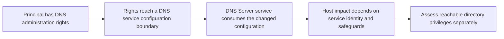

# DNSAdmins service control

The DNSAdmins group is intended to delegate administration of Windows DNS. On a domain controller running the DNS Server service, overly broad DNS administration can become host-level risk if a member can influence service configuration or extensions that the service loads. The effect depends on Windows version, service configuration and the exact delegated rights; group membership alone is not proof of code execution or domain compromise.

> **Authorized assessment only:** Review group membership and service configuration read-only. Do not change DNS service settings or restart production domain controllers as a test.

## Conceptual path

## Conditions and limits

The DNS service must be present and affected by the delegated configuration. Service identity, supported extension behavior, file and registry permissions, service restart requirements and host protections all affect impact. A DNSAdmins edge in a graph is a review lead, not a universal escalation path.

## Defensive review

Keep DNSAdmins membership small, role-based and reviewed. Prefer supported DNS management delegation, protect service configuration and extension-loading boundaries, and avoid unnecessary DNS Server roles on domain controllers.

## Detection and response

Alert on DNSAdmins membership changes, DNS service configuration changes, unexpected module/image loads and DNS service restarts. Correlate with directory changes, source identity and host telemetry. Preserve service and directory evidence before restoring known-good configuration.

## References

- [Microsoft: DNS Server security guidance](https://learn.microsoft.com/windows-server/networking/dns/dns-security)
- [BloodHound documentation](https://bloodhound.specterops.io/)
- [MITRE ATT&CK: Account Manipulation](https://attack.mitre.org/techniques/T1098/)
