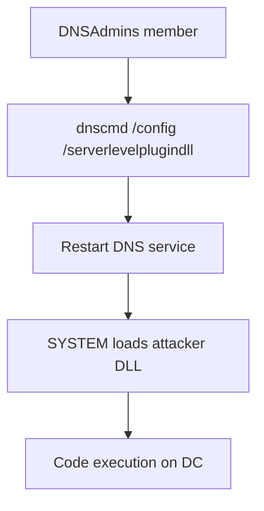

# DNSAdmins service control

### Affected object / attribute
**DNS service registry `ServerLevelPluginDll`** on a DC.

### Concept (deep)
`DNSAdmins` can set **`ServerLevelPluginDll`** via RPC. The DNS service runs as **SYSTEM on a DC** and loads the DLL on restart → **SYSTEM code execution on the DC**.

### Attack flow (Mermaid)


### Commands
```bash
