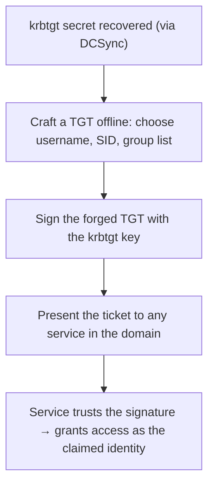

# Golden ticket

A golden ticket is a TGT protected using KRBTGT key material or an equivalent KDC context. The result can represent a domain identity and authorization context outside ordinary AS issuance.

> **Authorized assessment only:** This guide describes controlled, explicitly authorized assessment and defensive validation. It contains no target commands, exploit recipes, payloads, guessing parameters or real-target procedure.

## Beginner-friendly walkthrough

**In plain terms:** every Kerberos ticket (TGT) in the domain is signed with the secret key of one special account, `krbtgt`. If that key is ever recovered (usually via [DCSync](dcsync.md)), an attacker can sign their own ticket from scratch, claiming to be anyone — a brand-new "golden" ticket that the domain controller will accept as genuine, because it checks the same signature it always checks.

**Objects abused / affected**

| Object | Normal purpose | What this technique touches |
| --- | --- | --- |
| `krbtgt` account key | Signs every TGT the domain issues | Used to forge a TGT instead of receiving one from the KDC |
| Forged TGT | Normally proves "the KDC vouches for this identity" | Crafted directly, claiming any username/SID/group membership desired |
| SID history / group SIDs embedded in the ticket | Represent group membership for authorization | Can be set to arbitrary values (e.g. Domain Admins) in the forged ticket |

**Stages, and which tool typically covers each one**

1. **Prerequisite** — the `krbtgt` key must already be known; this is the direct payoff of a successful [DCSync](dcsync.md).
2. **Forge the ticket** — `Mimikatz`'s golden-ticket functionality or `Rubeus`'s equivalent builds a TGT offline using the recovered key and chosen identity/group values.
3. **Use it** — the forged ticket is loaded into a session and used like any normal TGT against any Kerberos-speaking service in the domain.

Because this bypasses the KDC entirely for issuance, the standard defense is not "detect the ticket" but "rotate the krbtgt key (twice, with the replication interval in between) after any suspected compromise," which invalidates every previously forged ticket.

## Relevant objects and normal purpose

KRBTGT account and key versions, KDC/DC, domain SID, TGT/PAC, ticket lifetime, clocks, account/SID fields and domain/forest scope are decisive.

## Prerequisite chain

The cryptographic KRBTGT context for the domain and a ticket accepted by DC/services are required. Old/current key state and ticket validation scope determine whether the ticket is accepted.

## Impact limits and failure cases

Domain scope, old/new KRBTGT keys, DC replication, clocks, account state, PAC validation and RODC/trust boundaries vary. Ticket lifetime or cryptographic success does not prove every resource is accessible.

## Detection and validation

Look for 4768/4769 inconsistencies, TGT use without a matching AS exchange, abnormal lifetime/PAC/client fields and unexpected DC/source hosts. Correlate KDC/DC integrity and account use.

Validate an impact hypothesis by correlating the relevant identity, directory, authentication, endpoint, network or cloud telemetry for the exact host, account and time. One event ID or tool label is not proof of success.

## Mitigation and recovery

**Mitigation:** Protect KRBTGT and DC administration, restrict replication rights and tier KDC access. Incident recovery follows Microsoft’s staged krbtgt rotation/recovery plan, waits for replication, and reviews sessions/tickets and affected secrets.

**Recovery:** Preserve evidence, isolate affected systems and identities, remove unauthorized state through approved procedures, review relevant credentials/sessions and retest in a clean lab.

## References

- [Microsoft: Kerberos authentication overview](https://learn.microsoft.com/windows-server/security/kerberos/kerberos-authentication-overview)
- [Microsoft: Credential protection](https://learn.microsoft.com/windows-server/security/credentials-protection-and-management/credential-protection-and-management)
- [Microsoft: Active Directory Domain Services](https://learn.microsoft.com/windows-server/identity/ad-ds/)
- [Microsoft: Security auditing](https://learn.microsoft.com/windows/security/threat-protection/auditing/security-auditing-overview)
- [MITRE ATT&CK: T1558.001](https://attack.mitre.org/techniques/T1558/001/)
