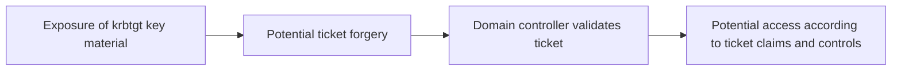

# Golden Ticket

## Concept

A Golden Ticket is a forged Kerberos ticket-granting ticket (TGT) signed using key material from the domain’s `krbtgt` account. A party with that key and relevant domain information may be able to construct tickets whose claims are accepted by domain controllers, subject to Kerberos validation rules and environment-specific controls. This represents a domain-level compromise, not an ordinary user-level weakness.

The signing key is exceptionally sensitive. It may be exposed through other serious failures, such as unauthorized replication access or compromise of directory database backups. A forged ticket is not automatically accepted for every service or indefinitely: ticket lifetimes, PAC validation, account and domain state, encryption support, replication, and newer defenses affect behavior. Claims that tickets for deleted or disabled users always work, or that a single `krbtgt` reset instantly invalidates every ticket, are overbroad.

## Prerequisites and affected assets

The prerequisite is compromise or exposure of the `krbtgt` account’s relevant key material, together with domain identity information. The affected boundary is the domain and services relying on its Kerberos authority. This is a critical incident even if no forged ticket has yet been confirmed. Avoid attempting ticket construction or use in production as a test.

## Detection

Correlate Kerberos service-ticket events (4769) with expected TGT issuance (4768), ticket lifetimes, encryption types, user and group claims, account existence, client addresses, and service access. Missing or anomalous related events can be useful but are not independently definitive: logging gaps, ticket caching, and normal timing can break simple pairwise rules. Use domain-controller telemetry and identity-protection signals, and investigate unusual privilege claims or authentication patterns.

## Remediation and recovery

Treat suspected `krbtgt` key exposure as domain recovery, with incident response and change control. Microsoft’s recovery guidance calls for two coordinated password resets, separated by sufficient time for replication and ticket/key rollover, with sequencing planned across domain controllers and trusts. A premature or poorly coordinated reset can disrupt authentication; follow current Microsoft documentation and validate replication before proceeding. Also remove the source of exposure, review replication permissions, protect backups, investigate persistence and credential access, and rotate other affected secrets.

## Limits and related topics

This technique depends on key compromise; it is not a way to elevate privileges without that prerequisite. Ticket behavior varies across Windows versions and domain configuration. See [DCSync](dcsync.md), [Silver Ticket](silver.md), and [Diamond Ticket](diamond.md).
