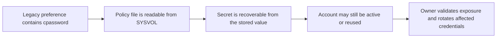

# Group Policy Preferences credential exposure

Older Group Policy Preferences could store a `cpassword` value in policy XML under SYSVOL. The value used a published encryption key and is not suitable for protecting a secret. Because SYSVOL is commonly readable by domain users, an old preference may expose a reusable password even when the policy is no longer actively applied.

> **Authorized assessment only:** Treat any discovered value as a secret. Do not attempt to authenticate with it; coordinate validation and rotation with the owner.

## Conceptual path

## Conditions and limits

The policy file must remain accessible and the associated account must still be valid for the value to create current risk. A found value is not proof of successful logon or privilege. Check account status, scope, reuse and last-change history through approved administrative processes.

## Defensive review

Remove legacy preference passwords, rotate every affected credential, and review for reuse in services, scheduled tasks and other managed systems. Use a supported secret-management mechanism with scoped access instead of policy-file storage.

## Detection and response

Periodically scan SYSVOL through approved defensive processes for legacy password fields. Correlate affected account logons and privilege, preserve the policy path and timestamps, remove the secret and rotate it with service owners.

## References

- [Microsoft: MS14-025 security update for Group Policy Preferences](https://learn.microsoft.com/en-us/security-updates/securitybulletins/2014/ms14-025)
- [MITRE ATT&CK: Credentials In Files](https://attack.mitre.org/techniques/T1552/001/)
