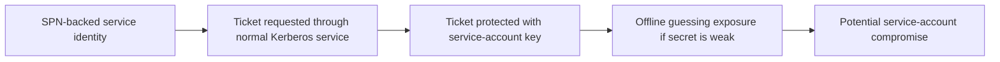

# Kerberoasting

## Concept

Kerberos clients can request a service ticket for a service principal name (SPN) registered in the domain. A portion of the ticket is protected using a key associated with the service account. An authenticated domain user who can request the ticket may therefore create an offline password-guessing exposure if the service account uses a guessable secret.

The request itself is a normal Kerberos operation, so a request is not proof of malicious activity. Offline guessing does not generate repeated domain logons or trigger account lockout in the same way as online guessing. Crackability depends on password strength, encryption type, and attacker resources. RC4 tickets are often easier to attack than modern AES-protected tickets, but AES does not make a weak password safe.

## Prerequisites and affected objects

A review needs an approved account inventory, SPN-to-owner mapping, encryption configuration, password age and management method, and an understanding of each identity’s privileges. Prioritize human-managed service accounts, stale SPNs, accounts with broad access, and identities reused across systems. An SPN is a configuration indicator, not proof that the associated account is exposed or weak.

Assess the least-privilege boundary of the service account and its credential storage. Managed service identities can reduce operational password risk, but deployment compatibility and permissions still need review.

## Detection

Review Event 4769 for unusual service-ticket request volume, rare SPNs, unexpected source systems, and RC4 encryption (etype `0x17`) where modern policy and workloads should use stronger options. Establish a baseline: legitimate applications may make bursts of requests and legacy dependencies may still require RC4. Correlate with identity, host, and service telemetry rather than treating any single ticket request as malicious.

## Remediation

Prefer group Managed Service Accounts or other supported managed identities where feasible. Otherwise use unique, long, randomly generated secrets with controlled rotation, minimize account privileges, eliminate obsolete SPNs, and migrate away from RC4 where compatibility allows. Review historical exposure before assuming a rotation alone is sufficient.

## Limits and related topics

Kerberoasting is distinct from [AS-REP roasting](asreproast.md), which concerns accounts configured without pre-authentication. This guide covers assessment and defense; it omits ticket collection and password-cracking procedures.
