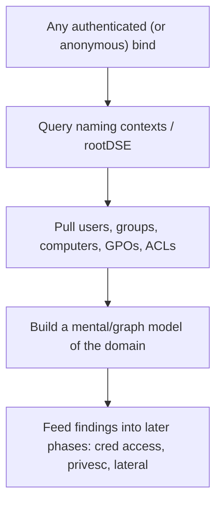

# LDAP / ADSI enumeration

LDAP is the directory discovery protocol used to enumerate AD users, groups, ACLs, GPOs, trusts and operational attributes. Enumeration is often normal and low impact alone.

> **Authorized assessment only:** This guide describes controlled, explicitly authorized red-team assessment, lab practice, and defensive validation. It contains no target commands, exploit recipes, payloads, guessing parameters or real-target procedure.

## Beginner-friendly walkthrough

**In plain terms:** LDAP enumeration is like being handed the company directory, the org chart, and the building's access-card log on day one. Nothing is "hacked" yet — you are just reading what Active Directory (AD) is willing to answer to anyone who can bind to it, so you know who the users, groups, computers and admins are before you try anything else.

**Objects abused / affected**

| Object | Normal purpose | What enumeration exposes |
| --- | --- | --- |
| User & group objects | Identity and membership | Usernames, group membership, admin counts, description fields (sometimes containing stray passwords) |
| Computer objects | Machine accounts | Hostnames, OS versions, which hosts are DCs |
| ACLs on objects | Who can read/write what | Which principal can modify a user, group, GPO or certificate template |
| GPOs | Policy delivery | Linked OUs, scripts, scheduled tasks |
| Trusts | Inter-domain/forest relationships | Directionality and transitivity an attacker could cross later |



**Stages, and which tool typically covers each one**

1. **Bind and discover scope** — confirm what naming contexts and attributes are readable under current rights. Tools like `ldapsearch-ad` and `windapsearch` work at this raw LDAP layer.
2. **Bulk collection** — pull the whole directory (users, groups, OUs, ACLs, trusts) in one pass. `ADRecon` and `ADPEAS` are built for this broad sweep and produce a readable report.
3. **Graph-focused collection** — `PowerView` and `ADSearch` let you ask targeted questions (e.g. "who can write to this group?") instead of dumping everything.
4. **ACL-specific pull** — `ADCollector` focuses on object ACLs/ownership, which is exactly the data that later feeds [ACL abuse](acl_abuse.md).

A directory attribute worth knowing, shown here only as a reference shape (not an attack recipe):

```text
distinguishedName: CN=Jane Doe,OU=Finance,DC=corp,DC=local
memberOf: CN=Domain Admins,CN=Users,DC=corp,DC=local
description: temp pwd Summer2026! (reset at next logon)
```

That `description` field is a classic example of sensitive data living somewhere nobody expected — the enumeration step is what surfaces it.


## Relevant objects and normal purpose

LDAP naming contexts and GC, rootDSE/referrals, bind/transport, objectClass/attributes and ACL visibility are central. Read rights differ for ordinary and sensitive attributes.

## Prerequisite chain

A bind session and network/ACL rights for the requested scope are required. Anonymous, authenticated and signed/channel-bound behavior varies by policy and client.


## Impact limits and failure cases

Search results depend on ACL visibility, GC/referral availability, replication lag, RODC/forest scope and endpoint policy. Readable metadata does not prove a usable secret or privilege path.

## Detection and validation

Monitor directory audit 4662 and LDAP bind/search volumes/sensitive attributes from unusual hosts. Baseline applications and identity inventory tools, and correlate source identity and search scope.

Validate an impact hypothesis by correlating the relevant identity, directory, authentication, endpoint, network or cloud telemetry for the exact host, account and time. One event ID or tool label is not proof of success.

## Mitigation and recovery

**Mitigation:** Restrict sensitive attribute read rights, LDAP signing/channel binding and management network access, and monitor anomalous enumeration. For unauthorized collection, preserve bind/search evidence, revoke identities, correct ACLs and assess whether the data enabled later access.

**Recovery:** Preserve evidence, isolate affected systems and identities, remove unauthorized state through approved procedures, review relevant credentials/sessions and retest in a clean lab.

## References

- [Microsoft: Active Directory Domain Services](https://learn.microsoft.com/windows-server/identity/ad-ds/)
- [Microsoft: Security auditing](https://learn.microsoft.com/windows/security/threat-protection/auditing/security-auditing-overview)
- [MITRE ATT&CK: T1087.002](https://attack.mitre.org/techniques/T1087/002/)
