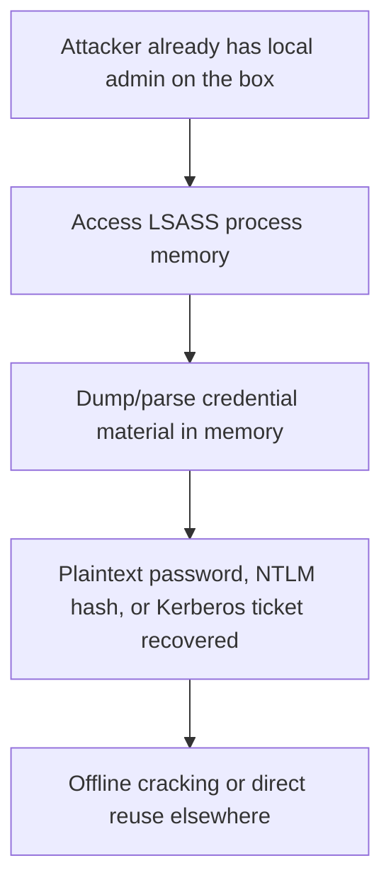

# LSASS memory dumping

LSASS credential dumping seeks secret/ticket material from LSASS process or logon state rather than directory or file stores.

> **Authorized assessment only:** This guide describes controlled, explicitly authorized assessment and defensive validation. It contains no target commands, exploit recipes, payloads, guessing parameters or real-target procedure.

## Beginner-friendly walkthrough

**In plain terms:** every time a user logs into a Windows machine, the operating system keeps a working copy of their credentials/ticket material in memory, inside a process called LSASS, so it doesn't have to ask them to re-type their password constantly. If an attacker already has admin rights on that machine, they can take a snapshot of that process's memory and pick through it offline for plaintext passwords, NTLM hashes or cached Kerberos tickets — like photographing an unlocked key cabinet instead of picking the lock.

**Objects abused / affected**

| Object | Normal purpose | What this technique touches |
| --- | --- | --- |
| `lsass.exe` process memory | Holds live logon session credential/ticket material | Read (dumped) by a local admin for offline parsing |
| Cached Kerberos tickets | Lets a user access services without re-authenticating | Extracted and can potentially be reused ("pass-the-ticket") |
| NTLM hash / DPAPI-protected secrets | Authentication material | Extracted for offline cracking or hash-based reuse |

**Stages, and which tool typically covers each one**

1. **Get the prerequisite** — this technique only applies once local admin (or an equivalent protected-process bypass) is already held; it is not itself a way to gain that access.
2. **Access and parse LSASS** — `Mimikatz` is the best-known tool for reading LSASS memory and extracting the structures that hold credential material (it also has well-documented EDR/Defender detection issues, which matters for a realistic assessment).
3. **Use the output** — recovered hashes feed into [pass-the-hash](pth.md); recovered tickets feed into [pass-the-ticket](ptt.md); recovered plaintext passwords can simply be tried against other systems.

This is also exactly why Credential Guard and LSA protection (`RunAsPPL`) exist — they are designed specifically to make step 2 much harder even for a local admin.

## Relevant objects and normal purpose

LSASS.exe and credential providers, logon sessions, Kerberos/NTLM/DPAPI state, LSASS protection/PPL/Credential Guard, process handle/access policy and endpoint security are relevant.

## Prerequisite chain

The process context needs OS/API permission to access LSASS, and credential material must exist in a usable logon/session context. PPL/Credential Guard/EDR can prevent access.

## Impact limits and failure cases

Credential Guard, HVCI/PPL, logon type, account state and session lifetime affect which artifacts remain usable. A memory fragment or hash may be stale or local-only.

## Detection and validation

Use process-access telemetry (Sysmon 10 or equivalent), LSASS memory dump/create events, protected-process/EDR alerts and subsequent authentication. Correlate account, source host and logon type.

Validate an impact hypothesis by correlating the relevant identity, directory, authentication, endpoint, network or cloud telemetry for the exact host, account and time. One event ID or tool label is not proof of success.

## Mitigation and recovery

**Mitigation:** Enable supported Credential Guard/PPL/HVCI and application control, restrict local admin/debug rights and privileged logons.

**Recovery:** Preserve evidence, isolate affected systems and identities, remove unauthorized state through approved procedures, review relevant credentials/sessions and retest in a clean lab.

## References

- [Microsoft: Credential Guard](https://learn.microsoft.com/windows/security/identity-protection/credential-guard/credential-guard)
- [Microsoft: Credential protection](https://learn.microsoft.com/windows-server/security/credentials-protection-and-management/credential-protection-and-management)
- [MITRE ATT&CK: T1003.001](https://attack.mitre.org/techniques/T1003/001/)
