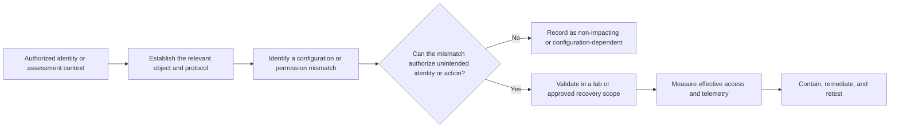

# Pass-the-passkey

FIDO2/WebAuthn passkeys use public-key credentials and challenge/response assertions to prevent simple replay of static secrets.

> **Authorized assessment only:** This guide describes assessment concepts and defensive validation for controlled, explicitly authorized environments. It does not provide target commands, exploit recipes, credential-guessing parameters, or step-by-step attack instructions.

## Relevant objects and normal purpose

Relying-party challenge, origin, authenticator, WebAuthn client, PRT/session artifacts, Entra Conditional Access, and federated sign-in.

Normally, these components perform directory lookup, authentication, authorization, certificate issuance, remote administration, or credential protection. A risk hypothesis should preserve this normal use and identify the narrow departure that would create unintended control.

| Review item | Normal role | What to validate |
| --- | --- | --- |
| Identity or account | Represents the requesting, delegated, or target security principal | Scope, group membership, SID, account state, MFA or authentication policy, and administrative tier |
| Directory or policy object | Stores configuration and authorization | Object type, attributes, ACL/owner, replication state, and documented business purpose |
| Protocol or service | Moves authentication or management information | Endpoint, signing/encryption, channel binding, version, patch state, and whether it is required |
| Resulting credential or ticket | Authorizes a bounded operation | Lifetime, purpose/EKU/SPN, issuer or KDC, target audience, and revocation or rotation behavior |

## Prerequisites and scope

Control of the relevant device/session and a realistic authorized scenario; a raw passkey assertion is origin-bound and must not be described as a reusable password.

**Typical prerequisites**

- Written authorization covering the identities, hosts, domains or tenants, data, and time window.
- A scoped account or lab artifact that exercises the relevant object or protocol without affecting unrelated systems.
- Visibility into directory state, authentication, endpoint, and audit telemetry sufficient to distinguish the hypothesis from normal administration.
- A recovery or rollback owner and approval for any configuration change or cleanup.

**Prerequisites should be confirmed rather than inferred.** Authenticator type (device-bound/synced), platform API, origin/RP-ID, user verification, challenge freshness, Conditional Access, hybrid join, and cloud tenant policy.

## Conceptual attack chain

The chain is conceptual: discovery establishes the object and normal trust relationship; a controlled validation establishes whether configuration and effective access preserve that trust; and impact is measured by the action or identity that a permitted principal can actually obtain. Stop at a negative or inconclusive result, and do not attempt to expand scope based on a tool label alone.

## Conditions and limits affecting impact

Replay of a static passkey assertion is generally not supported. Claimed impact should be scoped to the exact stolen session, key, or platform artifact and validated in the lab.

Other conditions frequently alter the result:

- **Patch and version:** Verify the exact OS, application, DC, CA, Entra, or protocol implementation. Vendor changes and security updates may remove a historical condition.
- **Scope:** Domain, forest, tenant, application, device, network segment, and resource authorization can narrow or broaden the effect.
- **Identity state:** Disabled accounts, expired credentials, Protected Users, authentication policies, account restrictions, and MFA may invalidate a theoretical path.
- **Cryptographic state:** Ticket/credential lifetime, key rotation, revocation, trust chains, certificates, and key protection are separate from directory permissions.
- **Telemetry completeness:** Missing or delayed logs do not prove absence; correlate identity, directory, endpoint, network, and application records.

## Defensive validation

Use independent checks rather than relying on a single alert or tool result:

1. Confirm that the object or protocol is present, required, and owned by a documented business role.
2. Resolve effective ACL, group, role, device, tenant, or service permissions, including inherited and nested rights.
3. Verify the configuration against the exact host, DC, CA, application, or tenant version in scope.
4. Attempt only approved read-only or lab-safe validation. Compare the observed identity and resulting privilege with policy.
5. Correlate the result with audit, authentication, directory, endpoint, network, and application telemetry.

The existing page-level telemetry note is: **FIDO2 authentication anomalies.** This is a starting hypothesis, not a standalone detection rule. Validate event schemas and enrichments for your Windows and cloud versions.

### Useful telemetry

| Source | Examples to correlate |
| --- | --- |
| Directory or identity audit | Object reads or writes, ACL/attribute changes, role changes, trust or credential configuration, and successful/failed sign-ins |
| Authentication/KDC or cloud sign-in | Account and source, protocol, KDC/DC or tenant, target SPN/resource, certificate or MFA method, and policy evaluation |
| Endpoint and process telemetry | Security process access, service or WMI activity, scheduled tasks, registry/hive access, remote-management sessions, and memory/integrity alerts |
| Network and DNS | SMB/RPC/LDAP/Kerberos/NTLM/HTTP/DNS flows, loopback or relay patterns, unusual source relationships, and destination endpoints |
| Certificate or key infrastructure | Request and issuance records, template use, key use, CRL/OCSP state, enrollment changes, and relying-party authentication failures |

Baseline the source, host, account, time, and expected administrative workflow before calling a sequence anomalous. A one-event match can be noisy or version-dependent.

## Mitigation and recovery

- Apply least privilege to directory objects, service identities, hosts, delegation relationships, CA templates, cloud roles, and local administrator groups.
- Keep systems supported and patched; use the vendor’s current security guidance and test mitigations for compatibility before broad deployment.
- Enforce strong authentication and administrative separation, including tiered administration, MFA/Conditional Access, Protected Users or equivalent policies, and credential isolation where appropriate.
- Restrict protocol and management surfaces by firewall, signing/channel binding, endpoint policy, and network segmentation. Remove unused templates, services, shares, subscriptions, or trust features.
- Centralize and retain identity, directory, endpoint, CA, DNS, and cloud logs. Alert on correlated state changes and abnormal effective access rather than isolated event IDs.

For suspected compromise, preserve evidence, isolate affected hosts or identities, revoke sessions and relevant credentials, rotate only with an approved incident plan, and verify replication and cache propagation. Some secrets require two-stage rotation or cross-domain/tenant cleanup because old keys, tickets, or credentials may remain effective until they expire or are replaced. Reassess with a clean or restricted test identity after recovery.

## Tools and validation discipline

No dedicated tool is listed in the page metadata.

No commands or payloads are provided on this page. Prefer vendor-supported inventories, directory queries in read-only mode, and purpose-built lab replicas for proof. Where the graph marks a tool, confirm that its collection mode is authorized and interpret its findings against live configuration.

## References

- [MITRE ATT&CK: T1550](https://attack.mitre.org/)

- [Microsoft: Microsoft Entra authentication and Conditional Access](https://learn.microsoft.com/en-us/entra/identity/conditional-access/overview)
- [MITRE ATT&CK: Cloud Account](https://attack.mitre.org/techniques/T1078/004/)
- [MITRE ATT&CK mapping](https://attack.mitre.org/techniques/1550/)

## Reporting checklist

- Exact environment, OS/DC/CA/tenant versions, domain or tenant scope, and assessment window.
- Objects and effective principals involved, with object distinguished names or resource IDs.
- Configuration values and the normal business purpose for each permission or protocol.
- Preconditions that were confirmed, rejected, or not testable.
- Observed impact, effective identity or privilege, and affected resource scope.
- Relevant directory, authentication, endpoint, network, certificate, and cloud telemetry.
- Remediation owner, rollback/rotation requirements, and verification criteria.
