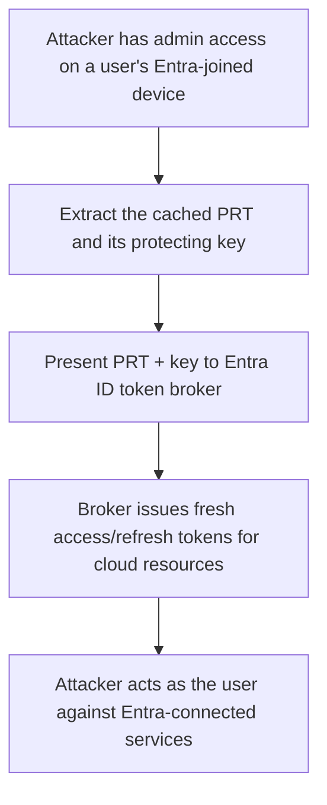

# Entra ID PRT pivoting

A Primary Refresh Token represents a joined-device/user sign-in context and can be exchanged by a supported broker for resource tokens under tenant policy.

> **Authorized assessment only:** This guide describes controlled, explicitly authorized assessment and defensive validation. It contains no target commands, exploit recipes, payloads, guessing parameters or real-target procedure.

## Beginner-friendly walkthrough

**In plain terms:** when a device is joined or registered to Entra ID, Windows caches a Primary Refresh Token (PRT) — essentially a long-lived "stay signed in" pass for that user on that device — so apps don't have to re-prompt for login constantly. If an attacker can extract that pass, they can ask Entra ID's broker to exchange it for fresh access tokens to other cloud resources, without ever seeing the user's actual password or MFA prompt again.

**Objects abused / affected**

| Object | Normal purpose | What this technique touches |
| --- | --- | --- |
| Primary Refresh Token (PRT) | Device-bound, long-lived sign-in artifact | Extracted and reused to mint new resource/access tokens |
| Device's session key / transport key | Protects the PRT cryptographically to the device | Needed alongside the PRT itself to actually use it elsewhere |
| Conditional Access device-compliance checks | Normally enforce "only known/compliant devices get tokens" | Bypassed in spirit, since the token exchange looks like it's coming from the already-trusted device |

**Stages, and which tool typically covers each one**

1. **Prerequisite** — admin-level access to a device already joined/registered to the tenant; this is a post-exploitation technique on an endpoint, not a remote attack on Entra ID itself.
2. **Extract the PRT material** — `ROADtools` and `AADInternals` both include functionality for reading cached PRT and session-key material from a compromised device.
3. **Exchange for tokens** — the same toolkits handle presenting the extracted material back to the token broker to mint usable access tokens for Graph, Exchange Online, SharePoint, etc.

Because the PRT is deliberately device-bound, the strongest mitigation is limiting what a compromised endpoint's identity is actually trusted to reach — conditional access policies, token protection ("token binding"), and treating any high-privilege user's device with the same care as a server.

## Relevant objects and normal purpose

Device join/registration state, PRT/broker/CloudAP and derived-key context, Entra account, target app audience, Conditional Access/token protection, device compliance, lifetime and revocation are involved.

## Prerequisite chain

A valid PRT/derived credential and matching broker/device context are required. The tenant/resource must accept the resulting token; PRT material is not an application password or automatically portable.

## Impact limits and failure cases

Device compliance, account/risk state, CA/MFA, token protection, OS/broker, key isolation and lifetime/revocation determine usability.

## Detection and validation

Monitor Entra sign-in/audit for PRT/broker exchange, new OS/device, risk/CA, refresh/token activity and device-registration/key changes.

Validate an impact hypothesis by correlating the relevant identity, directory, authentication, endpoint, network or cloud telemetry for the exact host, account and time. One event ID or tool label is not proof of success.

## Mitigation and recovery

**Mitigation:** Require supported broker/device compliance, CA/risk/token protection and remove stale devices.

**Recovery:** Preserve evidence, isolate affected systems and identities, remove unauthorized state through approved procedures, review relevant credentials/sessions and retest in a clean lab.

## References

- [Microsoft: Microsoft Entra identity documentation](https://learn.microsoft.com/entra/identity/)
- [Microsoft: Conditional Access](https://learn.microsoft.com/entra/identity/conditional-access/overview)
- [MITRE ATT&CK: T1550](https://attack.mitre.org/techniques/T1550/)
