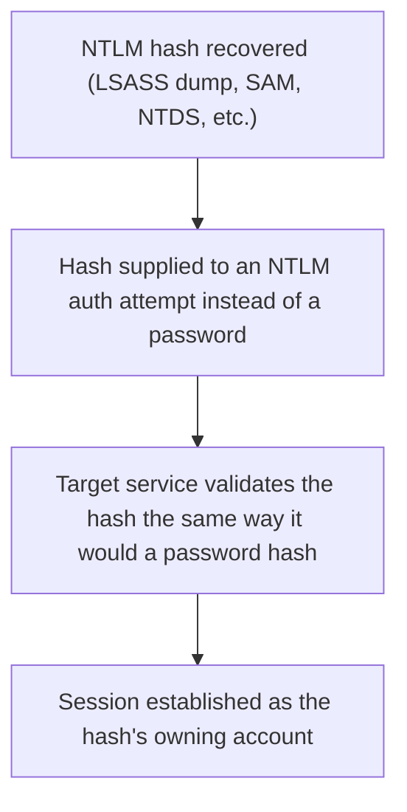

# Pass-the-hash

Pass-the-hash authenticates to NTLM-capable services using an NTLM key in place of the plaintext password. It is separate from Kerberos ticket and local privilege outcomes.

> **Authorized assessment only:** This guide describes controlled, explicitly authorized red-team assessment, lab practice, and defensive validation. It contains no target commands, exploit recipes, payloads, guessing parameters or real-target procedure.

## Beginner-friendly walkthrough

**In plain terms:** NTLM authentication never actually needs your plaintext password — it only ever needs the hashed form of it. That means if an attacker recovers the hash (e.g. from [LSASS memory](lsass_dump.md)), they can hand that hash straight to an NTLM-speaking service and be let in, exactly as if they had typed the password, without ever knowing what the password actually is.

**Objects abused / affected**

| Object | Normal purpose | What this technique touches |
| --- | --- | --- |
| NTLM hash | Internal credential representation used during NTLM auth | Used directly in place of a password; never "cracked" to get in |
| NTLM-capable service (SMB, WinRM, RDP-restricted-admin, etc.) | Normal remote access/file sharing | Accepts the hash as proof of identity |
| Local admin group on the target | Normal administrative control | If the account whose hash was stolen is a local admin elsewhere, PtH grants admin there too |

**Stages, and which tool typically covers each one**

1. **Prerequisite** — an NTLM hash must already be in hand, typically from [LSASS dumping](lsass_dump.md), a SAM/NTDS extraction, or a captured hash from a relay.
2. **Authenticate with the hash** — `Impacket`'s suite of remote-execution scripts and `NetExec` both accept a hash directly instead of a password for SMB/WMI/WinRM-style access.
3. **Scope check** — the hash is only as useful as the account's actual rights on the target host; a local-admin hash on one box does not automatically work everywhere (that's "lateral movement," not magic).

The practical defense isn't really detecting PtH itself (it looks like ordinary NTLM auth) — it's removing the *reason* PtH works at scale: shared local admin passwords across many machines (LAPS fixes this directly) and unnecessary NTLM where Kerberos could be enforced instead.

## Relevant objects and normal purpose

NTLM key/verifier, logon session, account SID/groups, NTLMSSP, SMB/RPC/WinRM/HTTP target, remote UAC, signing and target ACL are relevant.

## Prerequisite chain

A current account key, network reachability and a target that accepts NTLM for that account are required. The target authorizes the account and operation independently.

## Impact limits and failure cases

Remote UAC, NTLM policy, SMB signing/EPA, account type/state, domain trust, credential protection and target ACL limit impact. Hash material may be stale or domain/local constrained.

## Detection and validation

Correlate 4624 type 3 NTLMSSP, 4776 validation, source/target, unexpected interactive context and subsequent SMB/RPC/WinRM activity. Baseline normal service authentication.

Validate an impact hypothesis by correlating the relevant identity, directory, authentication, endpoint, network or cloud telemetry for the exact host, account and time. One event ID or tool label is not proof of success.

## Mitigation and recovery

**Mitigation:** Disable NTLM where compatible, enforce SMB signing/EPA and tiered privileged logons, enable Credential Guard and remote-UAC controls.

**Recovery:** Preserve evidence, isolate affected systems and identities, remove unauthorized state through approved procedures, review relevant credentials/sessions and retest in a clean lab.

## References

- [Microsoft: Windows authentication overview](https://learn.microsoft.com/windows-server/security/windows-authentication/windows-authentication-overview)
- [Microsoft: SMB security](https://learn.microsoft.com/windows-server/storage/file-server/smb-security)
- [Microsoft: Credential Guard](https://learn.microsoft.com/windows/security/identity-protection/credential-guard/credential-guard)
- [Microsoft: Credential protection](https://learn.microsoft.com/windows-server/security/credentials-protection-and-management/credential-protection-and-management)
- [MITRE ATT&CK: T1550.002](https://attack.mitre.org/techniques/T1550/002/)
