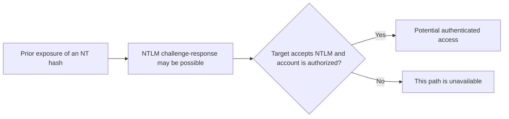

# Pass-the-Hash (PtH)

## Concept

NTLM challenge-response authentication uses a password-derived secret without sending the plaintext password over the network. In some NTLM authentication contexts, possession of an account’s NT hash can therefore enable authentication without first recovering the plaintext password. This is the basis of Pass-the-Hash (PtH).

PtH is not universal: it depends on NTLM being available, the account being valid in the target’s authentication context, and the account having the necessary access. Kerberos-only configurations, NTLM restrictions, network protections, and credential guardrails can limit exposure. A hash is still a credential-equivalent secret and should be handled accordingly.

## Prerequisites and affected systems

A finding requires evidence of exposed NT hashes and an environment that accepts the relevant NTLM authentication. Determine whether the identity is a domain account or a local account, whether passwords are reused, where that account has administrative rights, and what controls restrict NTLM. Local-account hash reuse across endpoints can create a broader lateral-movement risk than a unique local credential.

Do not infer that possession of a hash proves it was used, or that any one hash grants administrator access everywhere. Authorization is evaluated by each target and account context.

## Detection

Review Security Event 4624 for network logons (Logon Type 3), NTLM authentication package details, account, source host, and access pattern. Correlate with NTLM operational logs, endpoint telemetry, remote-management activity, and expected service behavior. A Type 3 logon is routine in many environments; unusual cross-host sequences, unexpected administrative accounts, or activity from atypical sources merit investigation. Confirm audit policy coverage.

## Remediation

Reduce NTLM use through a staged compatibility-aware policy, prioritizing sensitive systems. Use unique local administrator passwords through Windows LAPS, remove unnecessary local administrator rights, prevent credential reuse, protect credential material, and rotate affected secrets after exposure. Apply tiering and restrict remote administration pathways. See [Overpass-the-Hash](opth.md), [Pass-the-Ticket](ptt.md), and [LAPS/gMSA](laps_gmsa.md) for adjacent topics.

## Limits

This is an authentication-risk assessment, not an endorsement of credential replay. The guide intentionally excludes hash formats, command examples, and procedures for accessing targets.
