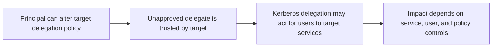

# Resource-Based Constrained Delegation (RBCD)

## Concept

Kerberos delegation permits a service to act on behalf of a user when accessing another service. In resource-based constrained delegation, the target resource’s directory object specifies which principals may act on its behalf. The relevant security descriptor is stored in `msDS-AllowedToActOnBehalfOfOtherIdentity`.

RBCD is a legitimate feature, not inherently a vulnerability. Risk arises when an untrusted or overly broad principal can change the target’s delegation policy, or when an inappropriate principal is already authorized. The ability to create computer accounts—sometimes influenced by MachineAccountQuota—may be relevant in some environments, but it does not alone grant RBCD rights or guarantee an escalation path.

## Prerequisites and affected objects

Assess computer and service objects with the delegation attribute set, the identities named in its security descriptor, who can modify that descriptor, and the target services and user populations involved. Review ACL inheritance, ownership, nested groups, MachineAccountQuota policy, and whether sensitive accounts are protected from delegation. Validate that each relationship has a service owner and documented business need.

A writable computer object or nonzero MachineAccountQuota is not sufficient by itself to establish exploitability. Delegation protocol constraints, SPN/service coverage, account privileges, encryption support, and target configuration determine possible impact.

## Detection

Monitor Event 5136 and equivalent directory-change telemetry for changes to `msDS-AllowedToActOnBehalfOfOtherIdentity`, especially on domain controllers, servers hosting sensitive services, and other high-value computer objects. Correlate the actor, originating system, before/after security descriptor, and approved change record. Audit newly created computer accounts and changes in effective write permissions as supporting context.

## Remediation

Limit write access to computer and service objects; remove unjustified delegate entries; and grant delegation only to named, managed principals for a defined service need. Set MachineAccountQuota according to organizational requirements, rather than assuming a default is safe or dangerous in isolation. Mark sensitive accounts as non-delegable where appropriate, and review unconstrained and classic constrained delegation separately.

## Limits and related topics

RBCD does not automatically enable impersonation to every service or arbitrary use of every identity. Validate exposure through configuration review and approved non-invasive methods. See [MachineAccountQuota](machineaccountquota.md), [constrained delegation](constrained_deleg.md), and [ACL abuse](acl_abuse.md).
