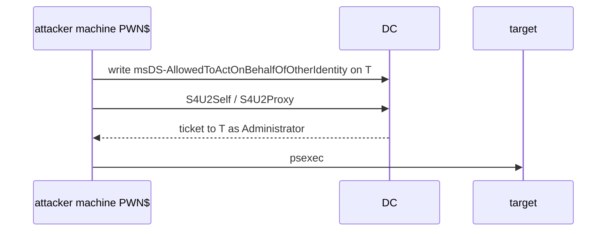

# Resource-Based Constrained Delegation (RBCD)

### Affected object / attribute
**`msDS-AllowedToActOnBehalfOfOtherIdentity`** on the **target computer object**.

### Concept (deep)
The target’s attribute names the delegate. If you can write it (GenericWrite/WriteDacl, or LDAP relay), set your machine account → **S4U2Self + S4U2Proxy** → impersonate DA to the target. Needs **MAQ>0** or an existing writable computer**.

### Attack flow (Mermaid)


### Exhaustive commands
```bash
