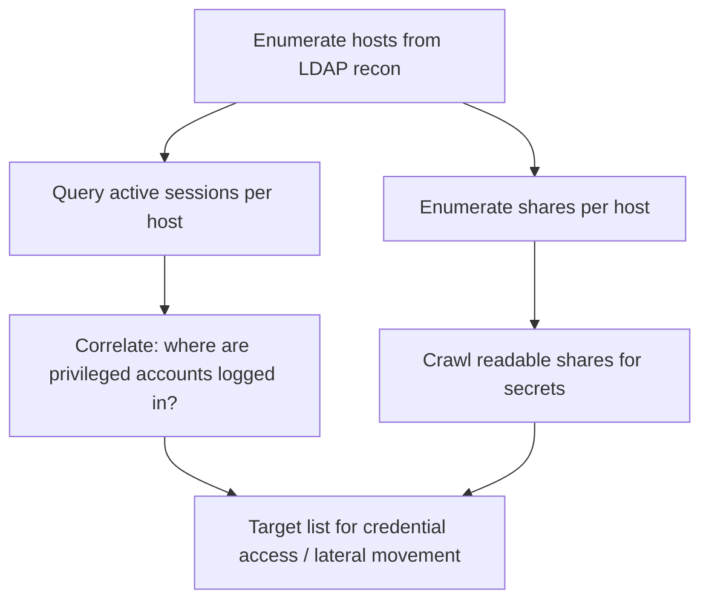

# Session & share reconnaissance

Session/share reconnaissance identifies active SMB sessions and shares, potentially revealing where accounts or resources exist. It does not prove data sensitivity or credential possession.

> **Authorized assessment only:** This guide describes controlled, explicitly authorized red-team assessment, lab practice, and defensive validation. It contains no target commands, exploit recipes, payloads, guessing parameters or real-target procedure.

## Beginner-friendly walkthrough

**In plain terms:** this is the equivalent of walking the office floor and noting whose badge opens which door, and which shared filing cabinets are unlocked. You are mapping *who is logged in where* and *what SMB shares exist*, which tells you where credentials and sensitive files are likely to live — without touching anything yet.

**Objects abused / affected**

| Object | Normal purpose | What this technique exposes |
| --- | --- | --- |
| SMB sessions (`NetSessionEnum`) | Lets admin tooling see active connections | Reveals which hosts a privileged user is currently logged into |
| SMB shares | File sharing between hosts | Reveals readable/writable shares that may hold credentials, scripts, backups |
| Share file contents | Business data | Config files, scripts and backups sometimes contain plaintext or weakly-protected secrets |



**Stages, and which tool typically covers each one**

1. **Session mapping** — `netexec` (the actively-maintained successor project to CrackMapExec) can sweep a host list and report active sessions, letting you see where a high-value account is currently connected.
2. **Share crawling** — `Snaffler` walks reachable shares looking for file names and contents that match known secret patterns (passwords, keys, config files).
3. **Targeted search** — `SauronEye` focuses specifically on finding files matching chosen keywords/regex across shares, useful once you know what you are looking for (e.g. "password", "unattend", ".kdbx").

A share ACL worth recognizing, shown as a reference shape rather than a live scan result:

```text
Share: \\FS01\Scripts$   Permissions: Everyone (Read)
Share: \\FS01\Deploy$    Permissions: Domain Users (Change)
```

A "Change" permission for a broad group like Domain Users on a share that holds deployment scripts is exactly the kind of finding this phase is meant to surface.


## Relevant objects and normal purpose

NetSessionEnum/NetShareEnum, SMB server, share ACL, DFS, source IP/account, 5140/5145 and endpoint/network visibility are involved.

## Prerequisite chain

Network/RPC/SMB reachability and account rights that permit the enumeration are required. Local policy and firewall determine visibility.


## Impact limits and failure cases

Session churn, share ACL, SMB/RPC policy, firewall, DFS, endpoint visibility and account privilege make results incomplete. A reachable share may not expose sensitive data or usable credentials.

## Detection and validation

Audit NetSessionEnum/share enumeration and 5140/5145 access, correlate source account/host and repeated admin/DFS/share discovery. Baseline approved inventory tools.

Validate an impact hypothesis by correlating the relevant identity, directory, authentication, endpoint, network or cloud telemetry for the exact host, account and time. One event ID or tool label is not proof of success.

## Mitigation and recovery

**Mitigation:** Restrict SMB/RPC enumeration and share exposure, tighten share/DFS ACL and segment networks.

**Recovery:** Preserve evidence, isolate affected systems and identities, remove unauthorized state through approved procedures, review relevant credentials/sessions and retest in a clean lab.

## References

- [Microsoft: Windows authentication overview](https://learn.microsoft.com/windows-server/security/windows-authentication/windows-authentication-overview)
- [Microsoft: SMB security](https://learn.microsoft.com/windows-server/storage/file-server/smb-security)
- [Microsoft: Active Directory Domain Services](https://learn.microsoft.com/windows-server/identity/ad-ds/)
- [Microsoft: Security auditing](https://learn.microsoft.com/windows/security/threat-protection/auditing/security-auditing-overview)
- [MITRE ATT&CK: T1135](https://attack.mitre.org/techniques/T1135/)
- [MITRE ATT&CK: T1049](https://attack.mitre.org/techniques/T1049/)
