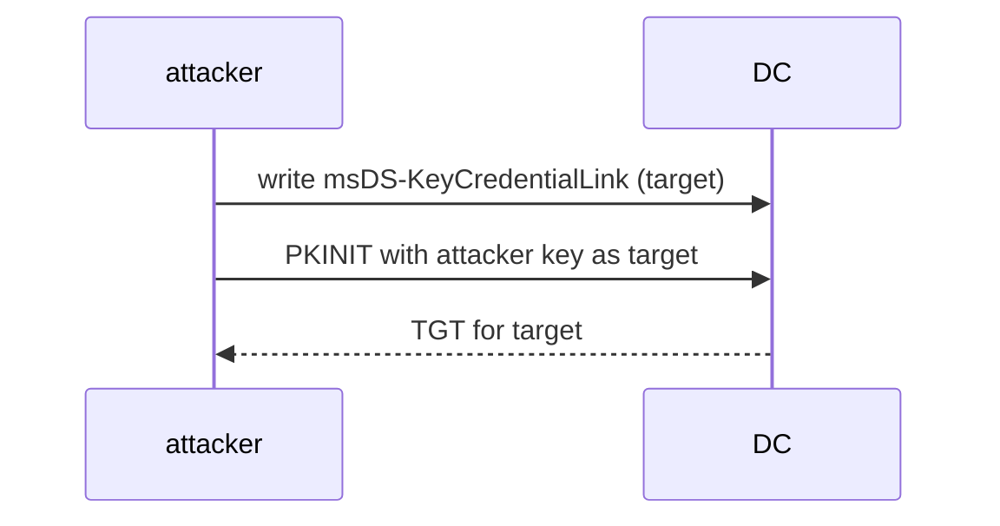

# Shadow Credentials attack

### Affected object / attribute
**`msDS-KeyCredentialLink`** on a user or computer.

### Concept (deep)
Write the attribute → inject your **public key** → target performs **PKINIT** with your key → you get the target’s TGT. No password needed. **Survives password resets** until the key is explicitly removed.

### Attack flow (Mermaid)


### Exhaustive commands
```bash
